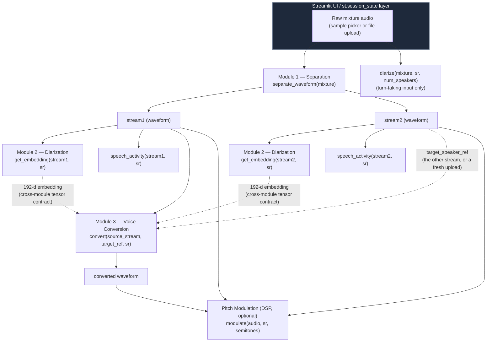
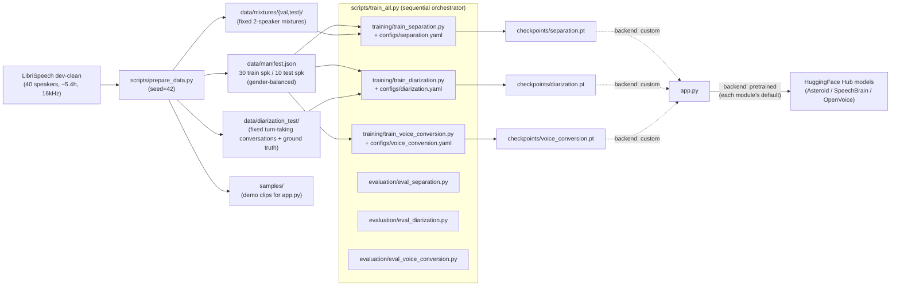

# Pipeline Integration — Ankush Pratham

CocktailFlow is built from three independently-trained machine learning modules —
speech separation, speaker diarization, and voice conversion — each owned by a
different team member and each swappable between a pretrained and a from-scratch
("custom") implementation. None of that is useful on its own unless the three
pieces can be composed into one coherent system that a user can actually run
end-to-end, reproduced identically by anyone who clones the repository, and
demoed interactively without needing to touch a terminal. That is this module's
job: the function-call contracts between the three ML modules, the shared data
and configuration conventions that keep training and evaluation honest, the
`scripts/train_all.py` orchestration script that rebuilds the whole project in
one command, and the interactive Streamlit application (`app.py`) that is the
system's actual user-facing deliverable.

---

## 1. Theory / Design Principles

Unlike the other three modules, there is no single deep-learning algorithm to
derive here — integration is a *systems-design* problem, not a *modeling*
problem. The theory below is about how independently-developed ML components
are safely composed, kept reproducible, and made interactive.

### 1.1 Why a minimal function-call API boundary matters

Each ML module exposes exactly the functions the rest of the system needs and
nothing else:

| Module | Public functions |
|---|---|
| Separation | `separate_waveform(audio)` → `(stream1, stream2)` |
| Diarization | `get_embedding(audio, sr)` → 192-d vector, `diarize(audio, sr, num_speakers)` → segments, `speech_activity(audio, sr)` → VAD mask |
| Voice Conversion | `convert(source_audio, target_speaker_ref, sr)` → waveform, `modulate(audio, sr, pitch_factor)` → waveform |

This is the classic **narrow-interface / wide-implementation** pattern: the
calling code (`app.py`, and the other modules when they depend on each other)
only ever imports these top-level functions, never a model class or a config
key from another module. Two things fall out of this for free:

1. **Backend swapping is invisible to callers.** Every module reads its own
   `backend: pretrained | custom` key from its own YAML file internally
   (`models/separation.py`, `models/diarization.py`, `models/voice_conversion.py`
   each call their own `load_config()` / `backend()` helper), so switching, say,
   diarization from SpeechBrain's pretrained ECAPA-TDNN to the from-scratch one
   requires editing one line of `configs/diarization.yaml` — `app.py` and every
   other module are completely unaware the swap happened, because they only ever
   call `get_embedding(audio, sr)`, never construct or configure a model
   themselves.
2. **Each team member's module is independently testable and independently
   broken-and-fixed.** As long as a module's public function keeps its
   signature and return contract, its internals (architecture, training
   recipe, checkpoint format) can change freely without touching any other
   module's code — a prerequisite for four people working on one pipeline in
   parallel without constantly merge-conflicting on each other's model code.

### 1.2 The one real cross-module tensor contract: the 192-d speaker embedding

Almost everything above is cleanly decoupled, but there is exactly one point
where two modules are coupled at the *tensor* level, not just the *function
signature* level, and it is the single most important integration detail in
the whole project.

`models/diarization.py:29` defines the shared constant `EMBEDDING_DIM = 192`,
which `models/voice_conversion.py:30` imports directly rather than
redeclaring. The custom AutoVC model's constructor asserts the two are in
sync at runtime, every time the custom model is instantiated
(`models/voice_conversion.py:169-175`: `assert dim_emb == EMBEDDING_DIM`,
raising a descriptive error naming both the local value and the imported
constant if they ever diverge). At actual inference time, `convert()`'s
custom-backend branch calls diarization's embedding function directly rather
than re-implementing a speaker encoder (`models/voice_conversion.py:393-397`,
via the thin L2-normalizing wrapper `speaker_embedding()` at lines 60-61,
which simply calls diarization's `get_embedding()` and divides by its norm).

**Why this matters architecturally:** AutoVC's decoder was trained to expect
a speaker-conditioning vector drawn from *one specific embedding space* — the
distribution of 192-d vectors produced by whichever diarization model was
active during `training/train_voice_conversion.py`'s training run. The runtime
`assert` above only checks that the *dimensionality* is 192 in both places —
it is a guard against a config typo (e.g. someone setting `dim_emb: 256` in
`voice_conversion.yaml`), not a guard against *distributional* mismatch. If a
user trains the custom AutoVC model while diarization's `backend` is
`custom` (the from-scratch 1.7M-parameter ECAPA-TDNN trained on 30 LibriSpeech
speakers), and later flips only `configs/diarization.yaml`'s `backend` to
`pretrained` (SpeechBrain's 20.8M-parameter ECAPA-TDNN trained on VoxCeleb),
the dimension check still passes — both produce 192-d vectors — but the
*actual numbers* in that vector now come from a completely different model
with a different geometry, which AutoVC's decoder has never seen. The
assertion is therefore a real but partial safety net: it catches the
catastrophic failure mode (dimension mismatch, which would crash with a shape
error) but not the subtle one (embedding-space mismatch, which would silently
degrade conversion quality with no error at all). The practical rule this
implies — "when training/using the custom AutoVC path, keep diarization's
backend fixed to whatever it was during AutoVC training" — is documented only
in code comments (`configs/voice_conversion.yaml:11`: *"Speaker embeddings
come from Module 2 (whichever diarization backend is active)"*), not enforced
by any runtime check tying the two backend choices together.

### 1.3 Reproducibility via a single seeded data split

All three training scripts, and the demo app's bundled sample clips, ultimately
trace back to one manifest built once by `scripts/prepare_data.py`
(`SEED = 42`, `scripts/prepare_data.py:42`). That script:

1. Downloads LibriSpeech dev-clean (40 speakers) if not already present
   (`scripts/prepare_data.py:49-57`).
2. Reads each speaker's gender from `SPEAKERS.TXT` and samples 5 female + 5
   male speakers (`NUM_TEST_SPEAKERS_PER_GENDER = 5`, line 43) as a
   **gender-balanced, seeded held-out test set** — 10 speakers total — with
   the remaining 30 speakers reserved for training (`build_manifest`,
   lines 72–102).
3. Within each *training* speaker, further splits utterances 90/10 into
   train/val (`VAL_FRACTION = 0.1`, line 44, applied at line 95).
4. Writes all of this once to `data/manifest.json`, which
   `training/data_utils.py:load_manifest()` (lines 29-34) loads and every
   training script (`train_separation.py`, `train_diarization.py`,
   `train_voice_conversion.py`) reads identically via the shared
   `speakers_in(manifest, split)` / `utterances(manifest, speaker, subset)`
   helpers (`training/data_utils.py:50-57`).

**Why this is the right design, not just a convenience:** three independently
trained models each need a train/test split, and if each module's training
script rolled its own random split, there would be no guarantee that, say,
diarization's "held-out" test speaker wasn't one of separation's training
speakers — which would make the project's central claim ("every reported
metric is on genuinely unseen speakers") unverifiable. By forcing all three
modules through one `manifest.json` built from one seeded `random.Random(42)`
instance, the project gets a single, auditable guarantee: the same 10 speaker
IDs are held out everywhere, and the same 30 are trained on everywhere.

`scripts/prepare_data.py` also builds the **fixed evaluation artifacts** from
this split — not just the manifest:

- `make_mixtures()` (lines 111–138) builds the fixed test-set two-speaker
  mixtures (`data/mixtures/test/`, 200 of them, drawn from the 10 held-out
  speakers, with a random ±5 dB relative gain and RMS normalization applied
  via `training/data_utils.py:rms_normalize`), plus a smaller validation set
  from training speakers' held-out utterances (`data/mixtures/val/`, used for
  checkpoint selection, not final reporting).
- `make_conversations()` (lines 141–166) builds the 30 fixed turn-taking
  "conversation" clips used for diarization's DER evaluation, again only from
  held-out speakers, concatenating trimmed utterances with literal silence
  gaps and recording ground-truth `(speaker, start, end)` segments to a CSV
  alongside each WAV.
- `make_samples()` (lines 169–179) copies three of the test mixtures and one
  conversation clip into `samples/`, which is exactly what `app.py`'s sidebar
  "Use sample" picker lists (see §4).

Because these test artifacts are generated **once, deterministically, from
the seed**, every module's reported metric and the demo app's sample clips are
drawn from the same fixed, literally-reproducible population — re-running
`prepare_data.py` on another machine regenerates byte-for-byte the same
speaker split (the test set mixtures/conversations depend on `rng.sample` /
`rng.choice` calls after the same seeded shuffles, so content can vary run to
run only if PyTorch/numpy/python versions change `random`'s implementation,
which they don't for `random.Random`).

### 1.4 Config-driven backend switching

All three `configs/*.yaml` files share the identical top-level pattern: a
`backend: pretrained | custom` switch, a `pretrained:` block naming the Hub
source, a `model:` block of custom-model hyperparameters, and a `training:`
block of training hyperparameters.

Each model module reads its own file via its own `load_config()`
(e.g. `models/diarization.py:257-263`) and branches on `backend()`
(`models/diarization.py:276`, `models/voice_conversion.py:390`, and the
equivalent in `models/separation.py:262`) to decide, at call time, whether to
construct the pretrained Hub model or load a locally-trained checkpoint. This
is the mechanism that makes the "6 code paths" (2 backends × 3 modules)
switchable with a one-line YAML edit and no code change — `app.py` never
checks or cares which backend is active; it just calls `separate_waveform()`,
`get_embedding()`, `diarize()`, `convert()`, `modulate()` and gets back
whichever backend's result.

### 1.5 Streamlit's execution model and why session state matters

A Streamlit script is **not** a long-running server loop that maintains
variables between interactions — the *entire* `app.py` file is re-executed
top-to-bottom every single time the user interacts with any widget (clicks a
button, moves a slider, uploads a file). Without special handling, clicking
the pitch-shift slider would re-run separation and voice conversion from
scratch on every single slider tick, which on CPU-bound models taking seconds
to run per call would make the UI unusable.

`app.py` solves this with Streamlit's `st.session_state` — a dict that
*does* persist across reruns within one browser session — and two specific
patterns:

**Pattern 1 — cache expensive results, recompute only on button click.**
Every expensive step (`separate_waveform`, `get_embedding`+`activity_spans`,
`diarize`, `convert`, `modulate`) is wrapped so it runs only inside an
`if st.button(...)` block, and its result is written into
`state[<key>]` (`app.py:184-189`, `218-227`, `243-246`, `279-291`,
`309-314`). Every other part of the script that *displays* that result reads
it back out of `state[<key>]` unconditionally, so the display logic re-runs
on every interaction (cheap) while the model call itself only re-runs when
its button is actually clicked.

**Pattern 2 — invalidate every downstream result when the input changes.**
`app.py` defines one list of all cache keys (`RESULT_KEYS`, line 33-34:
`['stream1', 'stream2', 'stream_sim', 'activity', 'diar_input', 'converted',
'conv_metrics', 'pitched']`) and one identity string for whatever audio is
currently selected (`input_id`, built per-input-method at lines 141 and 148 —
e.g. `f"sample:{selected}"` or `f"upload:{uploaded.name}:{uploaded.size}"`).
Immediately after determining the current `input_id`, the script compares it
against the previously-stored one and wipes every key in `RESULT_KEYS` from
`st.session_state` if they differ, then stores the new `input_id`
(`app.py:156-160`). This is the mechanism that prevents a classic Streamlit demo bug: switching
the input audio file and seeing *stale separated streams from the previous
file* still displayed because nothing told the UI the old results were no
longer valid. Note also the narrower, button-local reset at lines 187-189
(clearing `RESULT_KEYS` again right before writing a *new* separation result)
and the targeted invalidation at line 291 (`state.pop('pitched', None)` after
a fresh conversion, since a stale pitch-shifted clip of the *old* converted
audio would otherwise persist under "Converted output").

---

## 2. Architecture Diagrams

### 2.1 End-to-end runtime pipeline (what `app.py` actually executes)

The dotted arrows mark the one place a *tensor*, not just a file handle,
crosses a module boundary: the 192-d speaker embedding that diarization
computes is exactly what the custom voice-conversion backend feeds into
AutoVC's decoder as speaker conditioning (see §1.2).

### 2.2 Build-time data / config pipeline

---

## 3. Implementation Notes

### 3.1 `app.py` — sidebar input selection and session-state invalidation

Input selection is a radio toggle between a bundled sample and a user upload
(`app.py:133-150`). Both branches immediately decode the audio to a 16 kHz
mono numpy array via `librosa.load`, and both construct a short string
(`input_id`) that uniquely identifies *which* audio is currently selected —
for an upload, the filename plus byte size (a cheap proxy for "is this the
same file as last time" without hashing the whole buffer); for a sample, just
its filename. That `input_id` is exactly what §1.5's invalidation check
(`app.py:156-160`) compares against.

### 3.2 `run_step()` — turning model exceptions into UI messages

Every call into a model module's public API goes through one wrapper,
`run_step(label, fn, *args, **kwargs)` (`app.py:117-126`), which runs the call
inside a `st.spinner`, catches `FileNotFoundError` and surfaces it as a
friendly `st.error`, and catches any other exception as a visible
`st.exception` traceback rather than letting it crash the script. This exists
because every custom-backend model function raises
`FileNotFoundError` with an instructive message when its checkpoint is
missing (e.g. `models/separation.py:276-279`: *"No separation checkpoint at
...  Train it with `python training/train_separation.py` first."*) — without
`run_step`, a user who sets `backend: custom` before training anything would
get a raw Python traceback and a crashed script instead of a readable
in-app error message with a spinner showing which step is running. The
broad `except Exception` catch-all additionally means *any* unexpected model
error (a shape mismatch, an OOM, a corrupt checkpoint) degrades to a visible
`st.exception()` traceback in the page rather than taking down the whole
Streamlit process.

Every one of the three modules' calls in the main flow is routed through this
wrapper: `run_step("Running Conv-TasNet separation...", separate_waveform,
mixture)` (line 185), the embedding-extraction closure in the diarization tab
(line 225), `run_step("Running diarization...", diarize, mixture, SAMPLE_RATE,
int(num_spk))` (line 244), `run_step("Running voice conversion...", convert,
source, target_ref, SAMPLE_RATE)` (line 286), and
`run_step("Applying pitch shift...", modulate, audio_to_shift, SAMPLE_RATE,
float(pitch_factor))` (line 312).

### 3.3 The actual call sequence into each module

**Step 1 — Separation** (`app.py:184-198`): on button click, calls
`separate_waveform(mixture)` and stores the returned `(stream1, stream2)`
tuple directly into `state['stream1']` / `state['stream2']`.

**Step 2 — Diarization**, two independent tabs:
- *Separated streams* tab (`app.py:211-237`): calls `get_embedding()` on each
  already-separated stream and compares them with cosine similarity (local
  `cosine()` helper, line 113-114) as a sanity check that separation actually
  produced two different voices — plus `activity_spans()` (a thin wrapper
  around `speech_activity()`, lines 87-98) per stream to show each speaker's
  speech-activity timeline.
- *Diarize input* tab (`app.py:239-258`): calls `diarize(mixture, SAMPLE_RATE,
  int(num_spk))` directly on the **original, un-separated** mixture — this is
  the turn-taking use case (one speaker at a time), not the overlapping-speech
  use case, and the UI caption says so explicitly (line 240-241).

**Step 3 — Voice Conversion** (`app.py:279-291`): the user picks which
separated stream is the *source* and optionally uploads a different *target*
reference clip; if no target is uploaded, the **other** separated stream is
used as the target by default (lines 283-284) — i.e. by default this step
demonstrates "swap the two separated speakers' voices with each other." The
call is `convert(source, target_ref, SAMPLE_RATE)`, followed immediately by
three more `get_embedding()` calls (line 288) to compute similarity metrics
(converted-vs-target, converted-vs-source, source-vs-target-before-conversion)
purely for the UI's metric display — these are not needed by `convert()`
itself, which already did its own internal embedding lookups.

**Pitch modulation** (`app.py:304-314`): a simple dropdown (converted output,
or either raw stream) plus a semitone slider (−12 to +12) feeding directly
into `modulate(audio_to_shift, SAMPLE_RATE, float(pitch_factor))` — the only
step with no trained model involved at all (pure DSP, see the voice-conversion
module's own documentation for the phase-vocoder math).

### 3.4 `scripts/prepare_data.py` — speaker-split logic

`build_manifest()` (lines 72–102) is the function that actually produces the
train/test split described in §1.3. The gender-balancing is done by first
partitioning all 40 LibriSpeech dev-clean speakers by the `SPEAKERS.TXT`
metadata file (`read_genders()`, lines 60-69), then independently sampling
`NUM_TEST_SPEAKERS_PER_GENDER = 5` speakers from each gender pool as the
held-out test set via `rng.sample` (lines 77-80) —
guaranteeing the 10 held-out speakers are exactly 5 female + 5 male,
regardless of the overall gender ratio in LibriSpeech dev-clean. Every
remaining speaker (30 of them) is implicitly "train" (the per-speaker
dictionary set at lines 96-99 records `'split': 'test' if spk in
test_speakers else 'train'`). Within each speaker's utterance list, a
per-speaker 90/10 train/val split is then applied after a **seeded shuffle**
(`rng.shuffle(paths)`, line 94, followed by `n_val = max(1,
int(len(paths)*VAL_FRACTION))` and a slice at line 100-101) — this shuffle
uses the same `rng` object threaded through the whole script from the single
`random.Random(SEED)` created in `main()` (line 183), which is what makes the
entire split (test speakers, train/val per speaker, and every later
`rng.sample`/`rng.choice` call for building mixtures and conversations)
reproducible end-to-end from one seed.

### 3.5 `scripts/train_all.py` — orchestration sequence

A thin sequential subprocess runner: `run_step(description, command)`
(lines 31-44) shells out to each training/eval script in turn, times it, and
records pass/fail by exit code — no actual Python-level integration between
the steps, deliberately: each module is still trained by invoking its own
`training/train_*.py --config configs/*.yaml` entry point exactly as a user
would run it manually, so `train_all.py` is a convenience wrapper, not a
separate code path that could behave differently from running the steps by
hand. It runs, in order: `prepare_data.py` (only if `data/manifest.json`
doesn't already exist, line 58), then for each module: train → evaluate (plus
a `--tsne` visualization pass for diarization specifically, line 78-81), and
finally the full `pytest tests/` suite (lines 99-103). It ends by checking
that every expected deliverable file (three checkpoints, three loss-curve
images, five metrics CSVs/PNGs — the full list is enumerated at lines
119-131) actually exists on disk, printing a final `[SUCCESS]` or
`[WARNING]` summary (lines 133-144) — a cheap but effective reproducibility
smoke test: if any step silently failed to write its expected output, this
catches it even if that step's own exit code happened to be 0.

---

## 4. Configuration Reference

All three config files follow the same shape. The table below lines up the
concepts that are shared or must be kept consistent across modules; `—`
means the module has no equivalent concept.

| Concept | `separation.yaml` | `diarization.yaml` | `voice_conversion.yaml` |
|---|---|---|---|
| `backend` switch | `pretrained` (default) / `custom` | `pretrained` (default) / `custom` | `pretrained` (default) / `custom` |
| Pretrained source | `JorisCos/ConvTasNet_Libri2Mix_sepclean_16k` (Asteroid) | `speechbrain/spkrec-ecapa-voxceleb` | OpenVoice v2 (vendored in `third_party/openvoice`); `tau: 0.3` |
| **Shared embedding dimension** | — | `model.embedding_dim: 192` (comment: *"must match voice_conversion.yaml dim_emb"*) | `model.dim_emb: 192` (comment: *"= Module 2 embedding_dim"*) |
| Sample rate | 16000 Hz (hard-coded `SAMPLE_RATE` in `models/separation.py`) | 16000 Hz (hard-coded `SAMPLE_RATE` in `training/data_utils.py`, shared) | 16000 Hz (same shared constant; mel params fixed separately in `models/voice_conversion.py:audio_to_mel`) |
| Training steps/epochs | `training.steps: 4000` | `training.epochs: 30` | `training.steps: 8000` |
| Training crop length | `training.segment_sec: 2.0` | `training.crop_sec: 2.0` | `training.crop_frames: 128` (~2s) |
| Batch size | `training.batch_size: 4` | `training.batch_size: 32` | `training.batch_size: 16` |
| Learning rate | `0.001` | `0.002` (OneCycle peak) | `0.001` |
| Seed | `42` | `42` | `42` |
| Loss-specific hyperparameters | — (SI-SDR + PIT, no extra hyperparameters) | `loss.margin: 0.2`, `loss.scale: 30` (AAM-Softmax) | `loss.reconstruction_weight: 1.0`, `loss.content_consistency_weight: 1.0` |

The **`embedding_dim` / `dim_emb` = 192** pair is the one value that genuinely
must be kept in sync by hand across two files — it is documented with an
inline comment in both YAML files and additionally enforced at runtime by the
`assert dim_emb == EMBEDDING_DIM` in `models/voice_conversion.py:171` (see
§1.2), which reads the dimension from Python's `models/diarization.py:29`
constant rather than re-reading `diarization.yaml` — meaning the *source of
truth* for 192 is actually the Python constant, not either YAML file, and
both YAML files' `192` values are documentation that must be kept consistent
with that constant by a human, not derived from it automatically.

---

## 5. The Demo Application — User Journey

Walking through `app.py` as a user would experience it, top to bottom:

1. **Pick input audio** (sidebar, `app.py:133-150`): either choose one of the
   bundled `samples/sample_mixture_*.wav` (two overlapping speakers) or
   `samples/sample_conversation_*.wav` (turn-taking speech) clips, or upload
   your own WAV/FLAC/MP3. The sidebar caption (line 153-154) tells the user
   which sample type suits which downstream step.
2. **Inspect the input** (`app.py:175-182`): the app immediately plays the
   selected audio and shows its waveform and mel-spectrogram, so the user has
   a visual/audible baseline before running anything.
3. **Step 1 — Separate Speakers** (`app.py:184-198`): click the button; after
   a spinner, two audio players appear, each with its own spectrogram, one
   per separated speaker stream.
4. **Step 2 — Speaker Diarization**, choice of two tabs (`app.py:208-258`):
   - *Separated streams*: click "Analyse Speakers" to see each stream's
     speech-activity timeline plotted together, plus a cosine-similarity
     score between the two streams' voiceprints with an automatic
     warning if the two streams look like the *same* speaker (similarity
     > 0.6, line 233-236) — a built-in sanity check that separation worked.
   - *Diarize input*: pick an expected speaker count (1–6, default 2) and
     click "Diarize Input" to run full diarization directly on the raw,
     turn-taking input, producing a color-coded "who spoke when" timeline
     plus an expandable list of exact segment boundaries.
5. **Step 3 — Convert Voice** (`app.py:272-301`): pick which separated stream
   is the source speaker, optionally upload a different target-voice
   reference clip (otherwise the *other* separated stream is used as the
   target), click "Convert Voice". The result is played back alongside three
   similarity metrics (to-target, to-source, source-vs-target-before) so the
   user can judge numerically, not just by ear, whether the conversion moved
   the voice toward the target.
6. **Pitch Modulation** (`app.py:304-319`): pick any available audio (the
   just-converted output, or either raw stream), drag a −12..+12 semitone
   slider, click "Apply Pitch Shift" to hear the result.

Every step after Step 1 is gated behind `'stream1' in state` checks
(`app.py:215-216`, `268-270`) so the UI politely tells the user to run
separation first rather than crashing on a missing key if they jump straight
to a later section.

---

## 6. Known Limitations

- **The embedding-space contract is only dimensionally enforced, not
  distributionally enforced.** As detailed in §1.2, `assert dim_emb ==
  EMBEDDING_DIM` (`models/voice_conversion.py:171`) guarantees the custom
  AutoVC model always receives a 192-d vector, but nothing in the codebase
  checks or warns that AutoVC was trained against one *specific* diarization
  backend's embedding distribution. Switching `configs/diarization.yaml`'s
  `backend` after training the custom voice-conversion model silently feeds
  AutoVC out-of-distribution conditioning vectors with no error at all.
- **No true end-to-end automated test exists.** `tests/test_voice_conversion.py`'s
  `test_convert_calls_get_embedding` (lines 107-122) verifies the *wiring* —
  that `convert()` calls `get_embedding()` exactly twice — by mocking
  `models.voice_conversion.get_embedding` and `get_vocoder` with
  `unittest.mock.patch`, rather than running real audio through all three
  modules back-to-back and checking the final output. There is no test in the
  repository that imports `separate_waveform`, `get_embedding`/`diarize`, and
  `convert` together and asserts on a genuinely end-to-end result.
- **Upload-path error handling is inconsistent with the rest of the app.**
  The three `librosa.load(...)` calls that decode user-supplied audio
  (`app.py:140` for the main mixture upload, `app.py:147` for sample loading,
  and `app.py:282` for the voice-conversion target-reference upload) are
  **not** wrapped in `run_step()`'s try/except — unlike every model call,
  which is. A corrupted or unsupported audio file uploaded by a user will
  raise an unhandled exception directly from `librosa.load`, crashing the
  script with a raw traceback instead of the friendly `st.error(...)` message
  every model-side failure gets.
- **`scripts/train_all.py` orchestrates by exit code only.** It reports
  `[FAIL]` for any step whose subprocess returns non-zero, but does not stop
  the pipeline on a failed step — later steps that depend on an earlier
  step's checkpoint will still attempt to run (and likely fail too) rather
  than short-circuiting, so a single early failure can produce a long,
  partially-misleading cascade of `[FAIL]` entries in the final summary
  table (lines 112-114) rather than a clear single point of failure.
