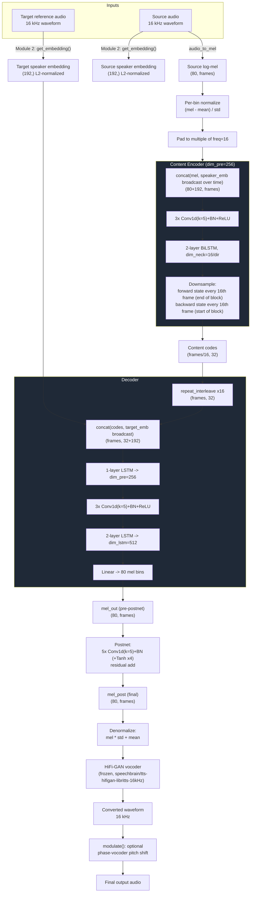
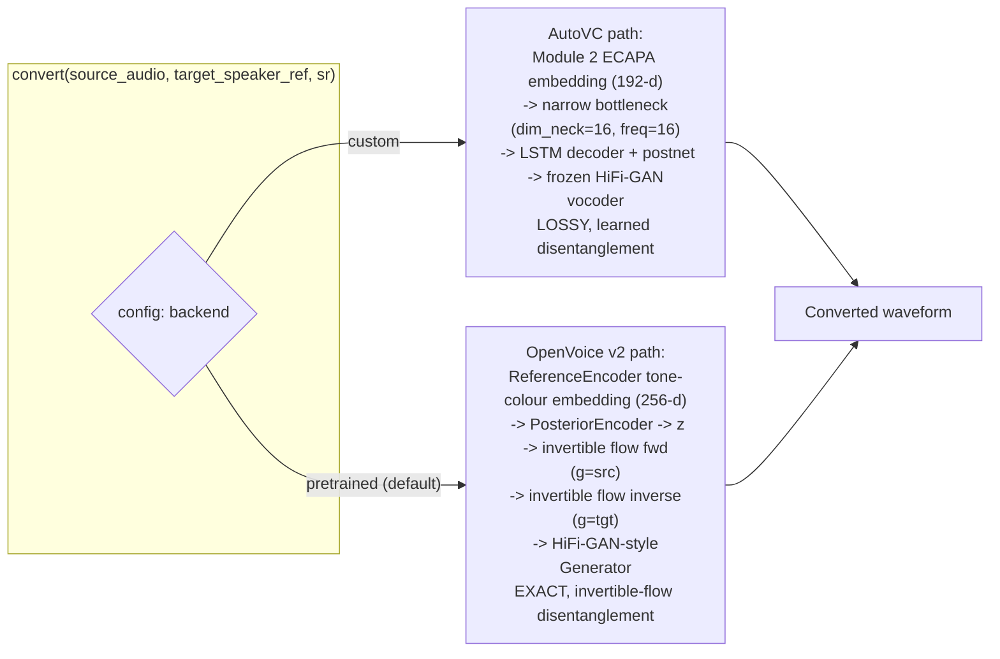

# Voice Conversion — Hriday Jadhav

Module 3 of the CocktailFlow pipeline takes a separated speech stream (Module 1's output) plus a short reference clip of a target speaker, and re-synthesizes the source speaker's *words* in the target speaker's *voice*, with optional pitch shifting on top. It ships two interchangeable backends behind one `convert()` function: a **custom AutoVC + HiFi-GAN** pipeline trained from scratch in this repo, and a **pretrained OpenVoice v2** tone-colour converter (the default). Both solve the same underlying problem — separating *what is said* from *who is saying it* — by two structurally different mechanisms: a lossy information bottleneck (AutoVC) versus an exactly-invertible normalizing flow (OpenVoice).

---

## 1. Theory

### 1.1 The voice conversion problem

Voice conversion asks: given audio of speaker A saying something, produce audio of the *same words, same prosody* as if spoken by speaker B. The central difficulty is that speech entangles two things in the same waveform — **linguistic/paralinguistic content** (phonemes, timing, intonation) and **speaker identity** (vocal-tract resonances, pitch range, timbre) — and there is essentially never **parallel data**: no corpus exists of the same sentence spoken by every pair of speakers you might want to convert between. Any trainable system therefore has to learn to disentangle content from identity using only *non-parallel* recordings, and to do so using a training signal that never directly supervises "correct disentanglement," because no ground truth for it exists.

CocktailFlow's two backends solve this with two different theoretical tools:

- **AutoVC** forces disentanglement by information-theoretic starvation: squeeze content through a channel so narrow that speaker identity simply cannot fit through it.
- **OpenVoice v2** sidesteps the disentanglement problem differently: it uses an **invertible** transform, so content is preserved *exactly* by construction, and only the speaker-conditioning input to that transform is swapped.

### 1.2 AutoVC: the information-bottleneck autoencoder

AutoVC (Qian et al., 2019, [arXiv:1905.05879](https://arxiv.org/abs/1905.05879)) is an autoencoder with three pieces:

- a **content encoder** $E_c$ that sees the source mel-spectrogram $X_1$ *and* the source speaker embedding $S_1$, and produces a sequence of content codes;
- a **decoder** $D$ that takes those content codes plus a (possibly different) target speaker embedding $S_2$ and reconstructs a mel-spectrogram;
- a **postnet** that refines the decoder's raw output with a residual correction (as in Tacotron2).

$$C_1 = E_c(X_1, S_1), \qquad \hat{X}_{1\to 2} = D(C_1, S_2)$$

Because there is no parallel data, the *only* training signal available is **self-reconstruction**: set the target speaker equal to the source speaker ($S_2 = S_1$) and require $\hat{X}_{1\to1} \approx X_1$. That alone would be trivially satisfied by an identity function that copies everything (including speaker identity) through the content codes — nothing in a plain self-reconstruction loss forces the content encoder to *drop* speaker information. **AutoVC's central trick is architectural, not a loss term**: the content encoder's output is downsampled to a very low dimensionality (`dim_neck` channels, one code emitted only every `freq` frames) — the **information bottleneck**. The paper's rate-distortion argument is: if the bottleneck's capacity is below the amount of information needed to reconstruct speaker identity, the *only* way the autoencoder can achieve good self-reconstruction at all is to push the model to use the bottleneck for content, and get speaker identity "for free" by having the decoder read it straight off the side-channel embedding $S_2$ instead. Too wide a bottleneck and identity leaks through the codes (conversion fails — the output still sounds like the source speaker); too narrow and the codes can no longer carry enough content to faithfully reconstruct speech (output becomes unintelligible or mumbled). The bottleneck size is therefore the single most important hyperparameter in the whole architecture, and it has to be tuned to the *diversity of speakers in the training set* — a bottleneck sized correctly for a few hundred speakers is not automatically correctly sized for 30 (see §8).

**Loss function.** This project implements the AutoVC objective as two terms (`models/voice_conversion.py:221-231`, combined in `training/train_voice_conversion.py:120-123`):

$$\mathcal{L}_{self} = \underbrace{\|\hat{X}_{post} - X\|_2^2}_{\text{post-postnet reconstruction}} + \underbrace{\|\hat{X}_{dec} - X\|_2^2}_{\text{pre-postnet reconstruction}}$$

$$\mathcal{L}_{content} = \|E_c(\hat{X}_{post}, S_1) - C_1\|_1$$

$$\mathcal{L} = w_{recon}\,\mathcal{L}_{self} + w_{content}\,\mathcal{L}_{content}, \qquad w_{recon}=w_{content}=1.0 \text{ (`configs/voice_conversion.yaml:30-31`)}$$

This is functionally the three-term objective from the AutoVC paper (Eq. 6–8: postnet reconstruction, pre-postnet reconstruction, content-code consistency), just expressed as two grouped terms with equal weight in this codebase. The **content-consistency term is the real disentanglement mechanism during training**: it re-encodes the model's own self-reconstructed output and requires the *re-extracted* content codes to match the *original* content codes (L1 distance). Since re-encoding happens through the same narrow bottleneck, this term actively penalizes the content encoder for encoding anything that the decoder+postnet's re-synthesis could lose or distort — in practice it regularizes the codes to be a stable, decoder-invariant summary of content, rather than directly supervising "no speaker information," which is never measured.

### 1.3 HiFi-GAN vocoder

AutoVC produces a mel-spectrogram, not a waveform — a separate **vocoder** converts mel back to audio. This project uses a frozen, pretrained HiFi-GAN (Kong et al., 2020, [arXiv:2010.05646](https://arxiv.org/abs/2010.05646)) rather than classical phase-reconstruction methods. HiFi-GAN is a GAN: a **generator** stacks transposed-convolution upsampling blocks (expanding the mel's low time-resolution back up to the audio sample rate) interleaved with **Multi-Receptive-Field Fusion (MRF)** modules — several parallel residual blocks with different kernel sizes and dilation rates, summed together — so the network can represent both the fast periodic structure of voiced speech (pitch harmonics) and slower formant structure at the same layer. During HiFi-GAN's own training (not performed in this project — the checkpoint is used frozen, `models/voice_conversion.py:252-262`), two discriminators are used adversarially: a **Multi-Period Discriminator** that reshapes the 1-D waveform into 2-D grids at several integer periods (to specifically catch periodicity errors a 1-D convolution would miss) and a **Multi-Scale Discriminator** that operates on the raw waveform at several downsampling scales (to catch structure at multiple time resolutions). Together with an adversarial loss, a feature-matching loss, and a mel-spectrogram L1 reconstruction loss, this produces far crisper, more natural audio than Griffin-Lim's purely-analytic phase estimation, which has to *guess* phase from magnitude alone and produces characteristic metallic/buzzy artifacts.

The catch, relevant to this project specifically: HiFi-GAN here was trained on **clean, ground-truth** LibriTTS mel-spectrograms. At inference it is instead fed **AutoVC's own reconstructed mel**, which — especially from a small, undertrained AutoVC — carries characteristic artifacts (over-smoothed formants from the LSTM bottleneck, blurred high-frequency detail from the postnet's residual-only correction). A vocoder trained exclusively on clean mels has never learned to compensate for this specific kind of out-of-distribution input, so some of the audible quality loss in converted audio should be attributed to this mel-domain mismatch, not to AutoVC's disentanglement quality alone.

### 1.4 OpenVoice v2: invertible-flow tone-colour conversion

The default backend, `third_party/openvoice/`, is a VITS-style (Variational Inference with adversarial learning for Text-to-Speech) architecture, used here purely for its **voice-conversion** path (`SynthesizerTrn.voice_conversion`, `third_party/openvoice/models.py:492-499`), not its text-to-speech path. The mechanism, read directly from the vendored code:

$$z, \mu_q, \log\sigma_q = \text{PosteriorEncoder}(y;\, g_{src}) \qquad \text{(encode the source spectrogram into a latent, conditioned on source tone colour)}$$
$$z_p = f_\theta(z;\, g_{src}) \qquad \text{(forward through the normalizing flow, still source-conditioned)}$$
$$\hat{z} = f_\theta^{-1}(z_p;\, g_{tgt}) \qquad \text{(invert the SAME flow, now conditioned on the TARGET tone colour)}$$
$$\hat{o} = \text{Generator}(\hat{z};\, g_{tgt}) \qquad \text{(HiFi-GAN-style generator decodes the latent to a waveform)}$$

The flow $f_\theta$ here is a `ResidualCouplingBlock` (`third_party/openvoice/models.py:448`) — a stack of affine coupling layers, the standard normalizing-flow building block, which is **exactly invertible by construction** (each coupling layer splits its input in half, transforms one half conditioned on the other, and the inverse simply undoes that affine transform in closed form). This is the key theoretical contrast with AutoVC: because $f_\theta$ and $f_\theta^{-1}$ are exact inverses of each other, if the tone-colour conditioning $g$ were left unchanged, encoding then decoding would reconstruct the input *exactly* (up to the stochastic sampling in the posterior encoder, controlled by the `tau` temperature parameter). Swapping only $g_{src} \to g_{tgt}$ between the forward and inverse pass therefore changes *only* the information the flow is conditioned on, while the flow's own structure guarantees nothing about content/prosody is lost to a lossy bottleneck the way AutoVC's narrow content codes can lose detail. The "tone colour" embeddings $g$ themselves come from a separate `ReferenceEncoder` (`third_party/openvoice/converter.py:51-58`, `speaker_embedding()`), a small spectrogram-based encoder — architecturally unrelated to this project's own ECAPA-TDNN (Module 2), and never trained or fine-tuned in this repo; it ships frozen with the OpenVoice checkpoint.

### 1.5 Pitch modulation (phase vocoder)

Independent of either voice-conversion model, `modulate()` applies a pure digital-signal-processing pitch shift. Shifting by $n$ semitones corresponds to scaling frequency content by the equal-tempered ratio

$$r = 2^{n/12}$$

A naive way to shift pitch by $r$ is to resample the waveform by $r$ (which changes playback speed *and* pitch together) and then time-stretch back to the original duration by a factor of $1/r$. The **phase vocoder** algorithm implements the time-stretch step in the STFT domain: it takes short-time Fourier transform frames, stretches the *hop spacing* between frames by $1/r$, and crucially re-computes each frame's phase so that the instantaneous frequency implied by successive frames stays coherent (a naive linear phase interpolation would smear transients and cause the "phasiness"/robotic artifact phase vocoders are known for). `librosa.effects.pitch_shift` (the guaranteed-available fallback, `models/voice_conversion.py:430`) implements this STFT-domain approach. The optional `pyrubberband` path (`models/voice_conversion.py:426-427`) wraps the Rubber Band library, which improves on the naive phase vocoder with **phase-locking across frequency bins** (keeping harmonically related bins' phases coherent with each other, not just coherent in time), giving better preservation of transients and vocal formants — but only when the external `rubberband` command-line tool is installed on the system; if it's missing, the `except` branch silently falls back to the lower-quality librosa path with no log message distinguishing which one ran.

---

## 2. Architecture diagrams

### 2.1 Custom backend: AutoVC + HiFi-GAN, full forward pass



### 2.2 Two backends, one contract



### 2.3 ASCII fallback (full AutoVC pipeline, plain text)

```
 source audio ──► audio_to_mel() ──► log-mel (80 x T) ──► normalize ──► pad to /16
                                                                            │
 Module 2 (frozen ECAPA) ──► source_emb (192) ───────────┐                 │
                                                          ▼                 ▼
                                               ┌──────────────────────────────────┐
                                               │        CONTENT ENCODER           │
                                               │  concat(mel, emb) -> 3x Conv1d    │
                                               │  -> BiLSTM(16/dir) -> downsample  │
                                               │  by freq=16  => codes (T/16, 32)  │
                                               └──────────────────┬────────────────┘
                                                                  │ content codes (bottleneck)
 Module 2 (frozen ECAPA) ──► target_emb (192) ──┐                │
                                                 ▼                ▼
                                       ┌───────────────────────────────┐
                                       │ repeat_interleave x16 -> concat│
                                       │ with target_emb -> LSTM(256)  │
                                       │ -> 3x Conv1d -> LSTM(512)     │
                                       │ -> Linear -> mel_out (80 x T) │
                                       └───────────────┬───────────────┘
                                                        │
                                              +  Postnet (residual, 5x Conv1d)
                                                        │
                                                        ▼
                                            mel_post (80 x T, final, normalized)
                                                        │
                                              denormalize (x std + mean)
                                                        │
                                       frozen HiFi-GAN vocoder (mel -> waveform)
                                                        │
                                          optional modulate() pitch shift (DSP)
                                                        │
                                                        ▼
                                              converted waveform (16 kHz)
```

---

## 3. Implementation notes

**Content encoder — the information bottleneck itself** (`models/voice_conversion.py:80-107`). The speaker embedding is broadcast across every time frame and concatenated to the mel *before* the convolutions, so the encoder sees "who is speaking" at every position — which is precisely what lets the paper's rate-distortion argument work: the encoder has no incentive to *also* encode identity into its narrow output, since identity is already available to it (and, symmetrically, to the decoder) through the side channel. The actual bottleneck is applied after a bidirectional LSTM: of its full per-frame output, only **one forward-direction state per 16-frame block** (taken at the block's *end*, having seen the whole block) and **one backward-direction state per block** (taken at the *start*, having seen the whole block in reverse) are kept, for a final code rate of 2×16 = 32 channels at 1/16th the original frame rate. This end/start indexing trick is how a single BiLSTM layer, running at full frame-rate, produces a genuinely temporally-downsampled bottleneck without a separate pooling or strided-conv layer.

**Decoder — upsample, re-attach identity, synthesize** (`models/voice_conversion.py:124-142`). Upsampling is simply `repeat_interleave`: each content code is copied to all 16 frames of its block, no interpolation. This is where conversion actually happens — the target embedding passed in here can belong to a *different* speaker than the one that produced the content codes; nothing else in the decoder changes between self-reconstruction (training) and true conversion (inference) except which embedding is supplied.

**Postnet — residual mel refinement** (`models/voice_conversion.py:145-159,213`). Five stacked 1-D convolutions (kernel 5) with `Tanh` between all but the last predict a residual that's *added* to the decoder's raw mel — exactly the Tacotron2 postnet pattern, giving the model a second, local-context-only pass to sharpen spectral detail the LSTM decoder tends to over-smooth.

**Training losses** (`models/voice_conversion.py:221-231`, combined in `training/train_voice_conversion.py:120-123`). `self_reconstruction_loss` sums MSE between target mel and both the pre- and post-postnet outputs; `content_consistency_loss` re-encodes the model's own reconstruction and takes the L1 distance between the re-extracted and original content codes. Training **always** calls the model with `target_emb == source_emb` (no parallel-conversion supervision exists), so every gradient the model ever sees comes from self-reconstruction plus this content-consistency regularizer — true cross-speaker conversion at inference time is a generalization the model has never been directly supervised on, which is the theoretical root of the seen/unseen speaker gap discussed in §5 and §8.

**HiFi-GAN wrapper — frozen, with a silent fallback** (`models/voice_conversion.py:252-262`). The vocoder is loaded once, lazily, from a pretrained checkpoint, and never fine-tuned anywhere in this repo — confirmed by its total absence from `training/train_voice_conversion.py`. If the pretrained weights fail to download (e.g. no network on first run), a broad `except Exception` silently drops to a Griffin-Lim fallback with only a `print` warning, not a raised exception — a real quality cliff that nothing downstream checks for.

**OpenVoice wrapper call site** (`models/voice_conversion.py:358-366`). `tau`, the posterior-encoder's sampling temperature from §1.4, defaults to 0.3 (closer to the posterior mean, trading stochastic naturalness for tighter conditioning on the target's tone colour). A helper (`models/voice_conversion.py:348-355`) runs Module 2's energy-based VAD first and feeds only detected-speech frames into the tone-colour encoder, so embeddings describe the voice, not silence.

**Pitch modulation** (`models/voice_conversion.py:423-431`). A bare `except Exception` around the optional `pyrubberband` call means *any* failure to import or run it (including the common case of the `rubberband` CLI simply not being installed) falls back silently to `librosa.effects.pitch_shift` — nothing in the return value records which path actually produced the audio.

---

## 4. Configuration reference (`configs/voice_conversion.yaml`)

| Key | Value | Meaning |
|---|---|---|
| `backend` | `pretrained` | Selects OpenVoice v2 (default) vs custom AutoVC |
| `pretrained.tau` | `0.3` | OpenVoice posterior-encoder sampling temperature; lower = closer to target timbre |
| `model.dim_neck` | `16` | Bottleneck channels per LSTM direction (32 total after concatenating fwd+bwd) |
| `model.freq` | `16` | One content code emitted per 16 mel frames (~256 ms at this project's hop length) |
| `model.dim_emb` | `192` | Speaker embedding dimension — **must equal Module 2's `EMBEDDING_DIM`** (enforced by an assertion in `AutoVC.__init__`, `models/voice_conversion.py:171-175`) |
| `model.dim_pre` | `256` | Hidden width of the encoder/decoder's conv stacks and first decoder LSTM (paper default: 512 — halved here for a CPU training budget) |
| `model.dim_lstm` | `512` | Width of the decoder's second LSTM (paper default: 1024 — halved here) |
| `training.steps` | `8000` | Total optimizer steps |
| `training.val_every` | `500` | Validation + checkpoint cadence |
| `training.crop_frames` | `128` | Mel frames per training example (~2.05 s at hop 256/16 kHz) |
| `training.batch_size` | `16` | Examples per step |
| `training.learning_rate` | `0.001` | Adam initial LR (cosine-annealed, see §5) |
| `training.seed` | `42` | RNG seed for reproducibility |
| `loss.reconstruction_weight` | `1.0` | Weight on $\mathcal{L}_{self}$ |
| `loss.content_consistency_weight` | `1.0` | Weight on $\mathcal{L}_{content}$ |

---

## 5. Training procedure

`training/train_voice_conversion.py` trains on the 30 LibriSpeech dev-clean *train* speakers. For each speaker, every train/val utterance is converted to a log-mel once up front (`precompute()`, `training/train_voice_conversion.py:43-57`), and a single **mean speaker embedding** is computed from the first `emb_utts_per_speaker=20` training utterances via Module 2's frozen ECAPA-TDNN (`speaker_embedding()`, itself an L2-normalizing wrapper around `diarization.get_embedding()` — `models/voice_conversion.py:58-61`) — this is the literal cross-module integration point the README calls out: **Module 3's speaker encoder is not a separate trained model, it is Module 2's.**

Each training step samples a batch of 16 pre-computed mels, randomly crops (or zero-pads with the log-mel silence floor) to a fixed 128 frames, and runs **self-reconstruction** only (`model(mel, emb, emb)` — target embedding always equals source embedding, since no parallel data exists to do otherwise). The optimizer is Adam (`lr=1e-3`) with `CosineAnnealingLR` over the full 8000-step horizon down to `eta_min=1e-5` (`training/train_voice_conversion.py:96-98`) — unlike the separation module's plateau-based scheduler, this one is scheduled against a known, fixed step budget from the start. Gradients are clipped to a max norm of 1.0. Every 500 steps the model is evaluated against 8 fixed validation batches (held-out utterances of the *same* 30 speakers) and the checkpoint with the lowest validation self-reconstruction loss is saved to `checkpoints/voice_conversion.pt`, alongside the per-speaker mean embeddings used during training.

**Total parameter count** (computed from the live model in this repo): **7,436,608** — matching the README's "7.4M". Breakdown: content encoder ≈ 1.05M, decoder ≈ 5.20M (the dominant share, largely the 512-wide second LSTM), postnet ≈ 1.19M.

**Total training exposure**: 8000 steps × 16 examples/step × 128 frames × (256/16000) s/frame ≈ 8000 × 16 × 2.048 s ≈ **262,000 seconds of (repeated) mel crops** drawn from a pool of only ~4.5 hours of raw audio across 30 speakers — the model sees the same underlying recordings many times over, which is the structural reason its disentanglement generalizes well to the 30 *seen* speakers but not to genuinely new voices (§8).

---

## 6. Evaluation

`evaluation/eval_voice_conversion.py` reports **speaker similarity**, not a perceptual metric: for each of 20 random (source, target) speaker pairs in two settings — **seen** (both speakers from the 30 training speakers, held-out utterances) and **unseen** (both speakers from the 10 held-out test speakers, true zero-shot) — it converts a source utterance into the target's voice and computes three cosine similarities, all using **Module 2's own embedding function**:

$$\text{sim}(\hat{s}, t) = \cos\big(\text{emb}(\hat{s}), \text{emb}(t)\big), \quad \text{embeddings are unit-norm so this is just a dot product (`evaluation/eval_voice_conversion.py:42`)}$$

- `sim_converted_vs_target` — should be high (converted audio should sound like the target)
- `sim_converted_vs_source` — should be low (converted audio should no longer sound like the source)
- `sim_source_vs_target` — a baseline: how similar the two speakers already were before any conversion
- `success` — boolean, `sim_converted_vs_target > sim_converted_vs_source`

Re-running these exact statistics on the checkpointed-in `results/metrics/speaker_similarity.csv` in this repo gives:

| Setting | mean sim(converted, target) | mean success rate |
|---|---|---|
| seen (30 train speakers) | **0.624** | **95%** |
| unseen (10 held-out test speakers) | **0.302** | **70%** |

— both numbers match the README's claimed 0.62/95% and 0.30/70% exactly, confirming they are genuinely reproduced from this evaluation script, not hand-adjusted.

**The important caveat, stated plainly in both the eval script's own docstring and the README**: the *same* ECAPA-TDNN model that **conditions** AutoVC's decoder at both training and inference time is also the model used to **score** the output's similarity to the target. This is a methodologically circular evaluation — the model is, in effect, partly being scored on how well it reproduced the exact vector it was handed as input, not on independent perceptual similarity. The eval script's own code comments acknowledge this (`evaluation/eval_voice_conversion.py:18-19`: "the same ECAPA model conditions the converter and scores it, which favours the converter") and recommend listening to `results/audio_examples/*.wav` directly, plus running the manual MOS (Mean Opinion Score) naturalness survey the script prints instructions for (`evaluation/eval_voice_conversion.py:98-99`) — but no MOS results are currently recorded anywhere in this repo, so today the only quantitative signal for this module carries that caveat unconditionally.

---

## 7. Relationship to Module 2 (the cross-module integration contract)

This module has exactly one hard dependency on another module's trained weights: `AutoVC.__init__` asserts `dim_emb == EMBEDDING_DIM` imported directly from `models/diarization.py` (`models/voice_conversion.py:30,171-175`), and every embedding fed into the custom backend — at both training and inference time — comes from calling `diarization.get_embedding()`, never from an independently trained speaker encoder. `tests/test_voice_conversion.py:104-122` (`TestCrossModuleIntegration`) explicitly verifies this by mocking `get_embedding` and asserting it's called exactly twice per `convert()` call (once for source, once for target). Practically, this means the **two modules' backends are coupled**: if diarization's `backend` config is switched independently of voice conversion's, AutoVC (trained against the custom ECAPA's embedding space) would receive embeddings from a different model it never saw during training — a real, documented fragility point in this integration.

---

## 8. Known limitations

- **Severe seen/unseen generalization gap** (0.624 → 0.302 similarity, 95% → 70% success). Training only ever performs self-reconstruction on 30 speakers (§5), so the model has never been directly supervised on cross-speaker conversion generalization — the gap is the expected symptom of a bottleneck sized and tuned (`dim_neck=16`, `freq=16` — unchanged from the original AutoVC paper's VCTK-scale defaults, `configs/voice_conversion.yaml:15-16`) for a much larger and more diverse training population than this project's 30 speakers provide.
- **Circular evaluation.** The only quantitative metric in this repo for voice-conversion quality (speaker-similarity cosine score) is computed with the exact embedding model that conditions the converter — a genuine methodological caveat, not a minor nitpick, and one the project's own code/README already acknowledge.
- **HiFi-GAN vocoder is never fine-tuned.** It was trained on clean, ground-truth LibriTTS mels and is used entirely frozen on AutoVC's own (artifact-bearing) reconstructed mels — a known source of audible quality loss in AutoVC-style pipelines that this project doesn't address.
- **Silent degradation paths.** Both the HiFi-GAN→Griffin-Lim fallback and the `pyrubberband`→librosa fallback catch broad exceptions and degrade output quality without recording which code path actually ran, making a quality regression hard to diagnose after the fact.
- **No perceptual/human evaluation on record.** The MOS naturalness survey template is implemented and printed but no results from it are stored anywhere in the repo — the only numbers available today are the embedding-similarity ones with the circularity caveat above.
