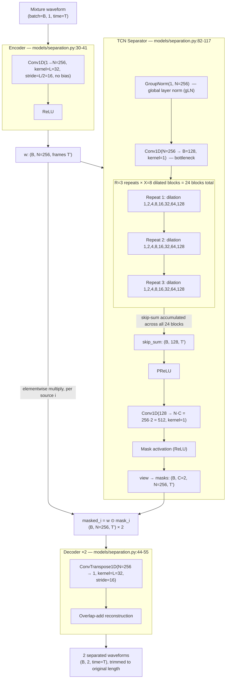
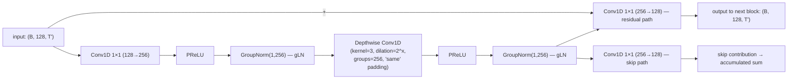

# Speech Separation — Prakhar Sahu

This document covers **Module 1** of the CocktailFlow pipeline: single-channel, two-speaker **speech separation** using **Conv-TasNet**. Given a 16 kHz mono recording containing two people talking over each other, this module produces two clean waveforms, one per speaker, with no prior knowledge of either voice. It is the entry point of the pipeline — its two output streams are consumed directly by Module 2 (speaker diarization / embeddings) and Module 3 (voice conversion), so everything downstream inherits whatever separation quality this module delivers.

---

## 1. Theory

### 1.1 The cocktail-party problem, and why time-domain separation

The "cocktail party problem" is the task of isolating one voice from a mixture of overlapping voices — something humans do almost effortlessly but which is a genuinely hard blind source separation (BSS) problem for a machine: we observe only the mixture waveform

$$x(t) = s_1(t) + s_2(t)$$

and must recover $s_1(t)$ and $s_2(t)$ with no microphone array, no prior speaker models, and (critically) no label telling the network which output should be "speaker 1" versus "speaker 2."

Classical approaches operate in the time-frequency domain: take an STFT of the mixture, estimate a **magnitude mask** per speaker in the spectrogram, multiply it onto the mixture spectrogram, and invert back to waveform. This has two structural weaknesses:
1. **Phase is discarded.** Masking is applied to the magnitude spectrogram, but the inverse STFT needs a phase estimate too — classically, this reuses the *mixture's* noisy phase, which caps the achievable reconstruction quality no matter how good the magnitude mask is.
2. **The STFT basis is fixed and hand-designed** (a bank of sinusoids at a chosen window/hop size), not tuned to what best separates speech.

**Conv-TasNet** (Luo & Mesgarani, 2019, [arXiv:1809.07454](https://arxiv.org/abs/1809.07454)) sidesteps both problems by working directly on the raw waveform in the time domain:
- A **learned encoder** (a single 1-D convolution) replaces the STFT with a basis that is optimized end-to-end for the separation objective rather than fixed in advance.
- Masks are estimated and applied **in this learned representation**, not in a magnitude spectrogram, so there is no separate phase to lose or reconstruct — the decoder inverts the *masked* representation directly back into a waveform.
- The separator is a **Temporal Convolutional Network (TCN)** — a fully convolutional, non-recurrent stack — instead of an RNN, which is both faster to train and able to use a very long receptive field cheaply, via dilation.

### 1.2 Architecture: Encoder → Separator → Decoder

**Encoder.** A single 1-D convolution plus ReLU maps the raw 1-channel waveform into an $N$-channel non-negative representation, analogous to a (learned) magnitude spectrogram:

$$w = \text{ReLU}(\text{Conv1D}(x)), \qquad w \in \mathbb{R}^{N \times T'}$$

where the convolution has kernel size $L$ and stride $L/2$ (50% overlap between frames, exactly like a windowed STFT), and $T' \approx 2T/L$ frames for a signal of length $T$ samples.

**Separator (TCN).** The TCN consumes $w$ and produces, for each of the $C$ sources, a mask $m_i \in [0,1]^{N \times T'}$ (or an unbounded ReLU mask, depending on configuration) of the same shape as $w$. Structurally, the TCN is $R$ **repeats** of $X$ **dilated convolutional blocks**, where block $x$ within a repeat uses dilation $2^x$ for $x = 0, 1, \dots, X-1$. Stacking exponentially-growing dilations lets the receptive field grow exponentially with depth while keeping every convolution small and the whole network fully parallelizable (unlike an RNN).

Each block is a **depthwise-separable convolution** with residual and skip connections (this is the part of the architecture that makes $R \times X$ blocks computationally cheap enough to stack many of them):
1. A $1\times1$ convolution projects the bottleneck channel count $B$ up to a wider hidden size $H$.
2. A depthwise (per-channel, grouped) convolution with the block's dilation operates over the time axis.
3. Two more $1\times1$ convolutions project back down: one as a **residual** output (added back onto the block's input, continuing to the next block) and one as a **skip** output (accumulated separately and used only at the very end).
4. PReLU nonlinearities and normalization sit between these steps.

Finally, the accumulated sum of all blocks' skip outputs is passed through PReLU and a final $1\times1$ convolution that expands to $N \times C$ channels, reshaped into $C$ masks of shape $(N, T')$, each passed through a mask activation (ReLU or sigmoid).

**Masking and decoding.** Each source's mask is applied to the shared encoder output by **elementwise multiplication**, and then the masked representation is inverted back to a waveform:

$$\hat{w}_i = m_i \odot w, \qquad \hat{s}_i = \text{Decoder}(\hat{w}_i) = \text{ConvTranspose1D}(\hat{w}_i)$$

The decoder is the transpose of the encoder (same kernel size $L$, same stride $L/2$), performing an overlap-add reconstruction: overlapping output frames are summed, which is exactly what a transposed convolution with stride < kernel size computes.

### 1.3 Permutation Invariant Training (PIT)

Because the network has no notion of "speaker 1" versus "speaker 2" — it only ever sees anonymous mixtures — there's a fundamental **label ambiguity**: for a 2-source mixture, the network's output channel 0 could correspond to either reference speaker, and channel 1 to the other. Training against a fixed assignment (output 0 ↔ reference 0 always) creates an ill-posed objective, because the "correct" assignment can flip from one training example to the next with no way for the network to know which it should produce.

**Permutation Invariant Training** (Yu et al.) resolves this by computing the loss **under every possible permutation** of outputs-to-references, and backpropagating only through whichever permutation gives the lowest loss:

$$\mathcal{L}_{\text{PIT}} = \min_{\pi \in \text{Perms}(C)} \sum_{i=1}^{C} \ell\big(\hat{s}_{\pi(i)}, s_i\big)$$

For $C=2$ sources there are exactly $2! = 2$ permutations to check — the identity assignment and the swap — so this is cheap: compute both candidate total losses and take the minimum (equivalently the maximum negative-SI-SDR score, since the loss here is negative SI-SDR). This is what lets the network train stably without ever being told which output "should" be which speaker; it simply learns to put two different speakers on two different output channels, in whichever order is easiest for a given mixture.

### 1.4 SI-SDR (Scale-Invariant Signal-to-Distortion Ratio)

A raw SDR/SNR metric penalizes any difference in **overall gain/scale** between the estimate and the reference, even if the separation is otherwise perfect — but Conv-TasNet's output scale is not explicitly constrained by the architecture, so a metric that's sensitive to amplitude mismatch would unfairly penalize an estimate that is, say, a perfect but 0.9×-scaled copy of the target. **SI-SDR** fixes this by first projecting the estimate onto the direction of the (zero-meaned) reference, isolating the component of the estimate that *is* the target at its best-fit scale, before measuring error:

$$s_{\text{target}} = \frac{\langle \hat{s}, s \rangle}{\|s\|^2}\, s, \qquad e_{\text{noise}} = \hat{s} - s_{\text{target}}$$

$$\text{SI-SDR} = 10 \log_{10}\frac{\|s_{\text{target}}\|^2}{\|e_{\text{noise}}\|^2}$$

Here $s_{\text{target}}$ is the orthogonal projection of the estimate $\hat s$ onto the span of the reference $s$ — the scalar $\frac{\langle \hat s, s\rangle}{\|s\|^2}$ is exactly the least-squares best-fit scale factor that makes $s$ look most like $\hat s$. Subtracting this projection from $\hat s$ leaves $e_{\text{noise}}$, the part of the estimate that **cannot** be explained by any rescaling of the reference — i.e. genuine distortion, not just a volume difference. Because the gain mismatch is projected out *before* the ratio is taken, multiplying $\hat s$ by any positive constant leaves the SI-SDR unchanged. This matters because Conv-TasNet's masking operation and decoder never explicitly constrain output energy — the network is free to emit a source at any gain, and SI-SDR (and training against it, see §1.3) ensures the model isn't penalized or rewarded for arbitrary output scale, only for getting the *shape* of the waveform right.

**SI-SDRi** (used at evaluation time) is simply the improvement in SI-SDR achieved by the model relative to doing nothing: $\text{SI-SDRi} = \text{SI-SDR}(\hat s, s) - \text{SI-SDR}(x, s)$, i.e. how much cleaner the separated stream is than the raw mixture, for the same reference speaker.

### 1.5 Receptive field of the TCN

Each block's dilated convolution has kernel size $P$ and dilation $d$, giving it a per-block receptive field contribution of $(P-1)\cdot d$ samples (in encoder-frame units) on each side (the code uses "same"-style padding, `(P-1)·d/2` on each side, so the sequence length is preserved — see §4). Stacking $X$ blocks per repeat with dilations $1, 2, 4, \dots, 2^{X-1}$, and repeating that $R$ times, the total receptive field in encoder frames is:

$$\text{RF}_{\text{frames}} = 1 + R \cdot (P - 1) \cdot \sum_{x=0}^{X-1} 2^{x} = 1 + R\,(P-1)\,(2^{X} - 1)$$

Each encoder frame spans $L/2$ samples of the original waveform (the encoder's stride), so the receptive field in **seconds** is:

$$\text{RF}_{\text{sec}} = \frac{\text{RF}_{\text{frames}} \cdot (L/2)}{f_s}$$

**Plugging in this project's actual custom-backend config** (`configs/separation.yaml`: $P=3$, $X=8$, $R=3$, $L=32$, $f_s = 16000$ Hz):

$$\text{RF}_{\text{frames}} = 1 + 3 \cdot (3-1) \cdot (2^{8}-1) = 1 + 3 \cdot 2 \cdot 255 = 1{,}531 \text{ frames}$$

$$\text{RF}_{\text{sec}} = \frac{1{,}531 \times 16}{16000} \approx 1.53 \text{ seconds}$$

So the model can in principle use roughly **1.5 seconds of context** on either side of any point in the signal when deciding how to mask it — comparable to, but slightly shorter than, the 2.0-second training crop length (`training.segment_sec` in the config), and meaningfully shorter than the up-to-4-second test mixtures it is evaluated on (see §7).

---

## 2. Architecture diagram

### Mermaid flowchart (with this project's actual custom-backend dimensions)



### One block in detail (`DepthwiseSeparableConv`, repeated 24×)



### ASCII fallback diagram

```
 Mixture x(t)                                         Separated s1(t), s2(t)
 (1, T) ──► [Encoder: Conv1D 1→N, k=L, s=L/2] ──► w (N, T')
                                                     │
                                                     ├─► [TCN Separator] ──► masks (C, N, T')
                                                     │        │
                                                     │   R=3 repeats x X=8 dilated
                                                     │   depthwise-sep conv blocks
                                                     │   (dilation 1,2,4,...,128;
                                                     │    residual + skip connections)
                                                     │
                                       w ⊙ mask_i ──►│  for i in {0,1}
                                                     ▼
                                    [Decoder: ConvTranspose1D N→1, k=L, s=L/2]
                                                     │
                                                     ▼
                                     overlap-add  ──► ŝ_i(t), i = 1,2
```

---

## 3. Implementation notes

### 3.1 Encoder — `models/separation.py:30-41`

The `Encoder` class is a single strided 1-D convolution (no bias term) mapping the raw waveform into `num_feats` channels, with stride `kernel_size // 2` giving 50%-overlapping analysis windows — exactly analogous to how an STFT uses overlapping frames, except the "basis functions" here are learned convolution filters rather than fixed sinusoids. A ReLU enforces non-negativity, so this representation behaves like a learned magnitude spectrogram that masks can multiply against.

### 3.2 TCN block — `models/separation.py:58-79`

`DepthwiseSeparableConv` implements the block described in §1.2. Its depthwise convolution uses `groups=hidden_channels`, meaning each hidden channel's filter only sees its own input channel rather than mixing across channels — this is the "separable" part of depthwise-*separable* convolution, and it's what keeps a 24-block-deep TCN computationally cheap (channel-mixing is handled entirely by the cheap $1\times1$ convolutions before and after). Normalization is `nn.GroupNorm(1, hidden_channels)` — a single group normalizing over *all* channels and the time axis jointly per-sample, which is exactly **global layer normalization (gLN)** as used in the Conv-TasNet paper. The block's `forward` returns two tensors: the residual path (added back onto the block's input, continuing to the next block) and the skip path (bypassing all subsequent blocks, accumulated separately — see §3.3).

### 3.3 Mask generation — `models/separation.py:82-117`

`TCNSeparator` builds the full stack: a `nn.ModuleList` of exactly $R \times X$ `DepthwiseSeparableConv` blocks, with dilation resetting to 1 at the start of each of the $R$ repeats — this is what §1.5's receptive-field formula assumes. Every block's skip output is accumulated into a running sum as the blocks are iterated; only this accumulated sum — not the final block's residual output — feeds the mask-generation head at the end (`output_prelu` → a $1\times1$ convolution expanding the bottleneck width $B$ directly to $N \times C$ channels → a mask activation → reshaped into one full-width mask per source).

### 3.4 Applying masks and decoding — `models/separation.py:143-174`

The top-level model's `forward` runs the encoder once, runs the separator to get per-source masks, then for each source multiplies the mask elementwise against the shared encoder output and passes the result through the decoder — exactly the $\hat w_i = m_i \odot w$ step from §1.2. The encoder and decoder weights are **shared across both sources**; only the masks differ between the two output streams. Before encoding, the input is right-padded so its length divides evenly into the encoder's stride, and the final output is trimmed back to the original length — this is what lets `test_output_length_odd_input` (§6) pass for arbitrary input lengths.

### 3.5 SI-SDR — `models/separation.py:181-199`

`si_sdr()` is a direct, numerically-stabilized implementation of the formula in §1.4: zero-mean both signals, project the estimate onto the reference to get $s_{\text{target}}$, subtract to get the residual $e_{\text{noise}}$, and take the log-ratio of their energies (a small epsilon guards both divisions against zero).

### 3.6 PIT loss — `models/separation.py:202-226`

`pit_loss()` enumerates the two $C=2$ permutations explicitly (the "straight" assignment and the "swapped" assignment) rather than via a general permutation loop, takes the better-scoring permutation **per example in the batch** (not per-batch), averages rather than sums over the two sources, and negates the mean so that minimizing this loss maximizes SI-SDR — a direct implementation of the formula in §1.3.

### 3.7 Public inference API — `models/separation.py:293-329`

`separate_waveform()` lazily loads and caches the model on first call (reading `backend` from `configs/separation.yaml` to decide between the pretrained Asteroid checkpoint and this project's own weights, `models/separation.py:253-286`), runs inference with gradients disabled, and then independently rescales each output stream so its peak matches the original mixture's peak amplitude. This rescaling exists because SI-SDR training (§1.4/§3.5) never constrains output gain — the raw network output could be arbitrarily quiet or loud — so the post-hoc rescale makes the audio audible and keeps it within $[-1, 1]$ for WAV export (see the limitation noted in §7). `separate(mixture_path)` is a thin wrapper that loads a file from disk via `librosa` at 16 kHz before calling this function.

---

## 4. Configuration reference

All values from `configs/separation.yaml`:

| Key | Value | Meaning |
|---|---|---|
| `backend` | `pretrained` | Which implementation `separate()`/`separate_waveform()` loads: `pretrained` (Asteroid Conv-TasNet, default) or `custom` (this project's model, below). |
| `pretrained.source` | `JorisCos/ConvTasNet_Libri2Mix_sepclean_16k` | HuggingFace Hub id of the pretrained Asteroid Conv-TasNet, trained on the full Libri2Mix `sep_clean` 16 kHz set (~212 h). |
| `model.enc_kernel_size` (**L**) | `32` | Encoder/decoder convolution kernel size (stride = L/2 = 16 samples = 1 ms at 16 kHz). |
| `model.enc_num_feats` (**N**) | `256` | Number of encoder output channels (paper default: 512 — halved here for a CPU-sized model). |
| `model.num_sources` (**C**) | `2` | Number of simultaneous speakers the model separates. |
| `model.msk_kernel_size` (**P**) | `3` | Kernel size of each TCN block's depthwise dilated convolution. |
| `model.msk_num_feats` (**B**) | `128` | Bottleneck channel width inside the TCN (matches paper default). |
| `model.msk_num_hidden_feats` (**H**) | `256` | Hidden channel width inside each TCN block (paper default: 512 — halved here). |
| `model.msk_num_layers` (**X**) | `8` | Number of dilated blocks per repeat (dilation doubles each layer: 1,2,4,...,128). |
| `model.msk_num_stacks` (**R**) | `3` | Number of repeats of the X-block stack (24 blocks total). |
| `model.msk_activate` | `relu` | Nonlinearity applied to the raw mask logits (`relu` or `sigmoid`). |
| `training.steps` | `4000` | Total optimizer steps. |
| `training.val_every` | `500` | Validate (and possibly checkpoint) every N steps. |
| `training.segment_sec` | `2.0` | Length of each randomly-cropped training mixture, in seconds. |
| `training.batch_size` | `4` | Mixtures per training step. |
| `training.learning_rate` | `0.001` | Adam initial learning rate. |
| `training.weight_decay` | `0.0` | L2 weight decay (disabled). |
| `training.grad_clip` | `5.0` | Max gradient norm (gradient clipping threshold). |
| `training.seed` | `42` | RNG seed for reproducible dynamic mixing and weight initialization. |

---

## 5. Training procedure

Training (`training/train_separation.py`) uses **dynamic mixing**: rather than training on a fixed, pre-rendered set of mixtures, `DynamicMixDataset` (`training/train_separation.py:41-73`) is an `IterableDataset` that, on every single training step, draws **two different random speakers** from the 30 train speakers, picks a random utterance from each, takes a random `segment_sec`-long crop directly from disk (`sf.read(..., start=..., frames=...)`, avoiding a full-file load), RMS-normalizes both to $-25$ dB, applies a random relative gain of $\pm 5$ dB between the two speakers plus an overall level-augmentation gain of $\pm 6$ dB, and sums them into a fresh mixture. Because every step sees a new speaker pair, a new pair of utterances, and new random crops/gains, this generates effectively unlimited training variety out of only about 4.4 hours of raw audio (30 train speakers × ~5.4 h / 40 total speakers × 90% train-split per speaker).

**Optimizer and schedule:** Adam (`lr=1e-3`, no weight decay), gradient-clipped to a max norm of 5.0, with `ReduceLROnPlateau(factor=0.5, patience=2)` stepped on validation loss every `val_every=500` steps.

**Validation and checkpointing:** validation uses a *fixed* set of mixtures built from held-out utterances of the same 30 train speakers (`FixedMixDataset` reading `data/mixtures/val/`, `training/train_separation.py:76-91`) — this is a different, more reproducible measurement than the ever-changing training stream, and is what the LR scheduler and best-checkpoint selection (`training/train_separation.py:156-161`) actually watch. The checkpoint with the lowest validation PIT loss is saved to `checkpoints/separation.pt`; training does **not** save optimizer/scheduler state, so an interrupted run can only be restarted from scratch, not resumed.

**Total audio exposure.** With `steps=4000`, `batch_size=4`, and `segment_sec=2.0`:

$$\text{Audio seen} = 4000 \times 4 \times 2.0\,\text{s} = 32{,}000\,\text{s} \approx 8.9\ \text{hours}$$

This is drawn (with replacement, via random cropping) from roughly 4.4 hours of *unique* raw audio — meaning every ~2.0-second crop is, on average, sampled about twice over the course of training. The README reports this run taking about 81 CPU-minutes.

---

## 6. Evaluation

`evaluation/eval_separation.py` measures **SI-SDRi** (SI-SDR improvement over the unprocessed mixture) on the fixed test set built by `scripts/prepare_data.py`: **200 two-speaker mixtures**, up to 4.0 seconds each (`MIX_MAX_SEC = 4.0`), drawn exclusively from the **10 held-out test speakers** that never appear in training (`scripts/prepare_data.py:124`, `:197`) — each mixture pairs two held-out speakers at a random relative gain of $\pm 5$ dB, same as the training-time augmentation.

For each test mixture, `compute_si_sdri()` (`evaluation/eval_separation.py:25-40`) computes $\text{SI-SDR}(\hat s, s) - \text{SI-SDR}(x, s)$ for the estimate against its reference; because PIT's label ambiguity applies at evaluation time too, `evaluate()` computes the SI-SDRi under **both** possible stream-to-speaker assignments (`sisdri_p1`, `sisdri_p2`, `evaluation/eval_separation.py:92-94`) and reports whichever is higher — exactly the same permutation-invariant logic as the training loss (§3.6), just applied to the evaluation metric instead of a training gradient.

**Actual results** (read directly from `results/metrics/separation_sisdri.csv`, which this evaluation script produces):

| Metric | Value |
|---|---|
| Mean SI-SDRi | **3.72 dB** |
| Median SI-SDRi | **3.81 dB** |

These match the README's reported "3.7 dB mean / 3.8 dB median" to one decimal place — the headline numbers are genuinely reproduced from this exact CSV, not just copied forward. For context, the README states the **pretrained** Asteroid Conv-TasNet (same architecture, trained on the full ~212-hour Libri2Mix set instead of this project's ~8.9-hour exposure) reaches roughly **15 dB SI-SDRi** on the same test set — a gap fully consistent with the ~24x difference in total training-data exposure (8.9h vs. 212h), not a sign of a bug in this implementation.

---

## 7. Known limitations

- **Undertrained relative to the architecture's capacity.** At ~8.9 hours of (repeated) audio exposure against ~4.4 hours of unique source material, the model is far short of the hundreds of hours typically used to train Conv-TasNet in the literature; the README itself notes training was "still improving when training stopped," meaning 3.7 dB SI-SDRi is a lower bound on what this exact architecture could reach with more compute, not a ceiling.
- **Receptive field is shorter than the test-time utterance length.** As computed in §1.5, the custom model's TCN receptive field is ≈1.53 s, close to but under the 2.0 s training crop, and meaningfully shorter than the up-to-4.0 s mixtures used for evaluation (§6) — the model never had to learn to use context beyond what it saw cropped at train time.
- **Hardcoded to exactly 2 sources at the loss level.** `pit_loss()` (§3.6) explicitly indexes `estimates[:, 0]` / `estimates[:, 1]` rather than enumerating permutations generically; although `ConvTasNet`/`TCNSeparator` accept a general `num_sources` parameter, changing it away from 2 would silently break training (the loss would not account for the extra source) with no error raised.
- **Output gain is a post-hoc heuristic, not learned.** Because SI-SDR training (by design) never constrains output amplitude, `separate_waveform()` rescales each stream independently to match the mixture's peak (§3.7) — if a stream's true energy is very low (e.g., a near-silent/failed separation for one speaker), this can rescale residual noise up to full peak loudness rather than silence.
- **Single-channel, exactly-two-speaker assumption throughout.** The pipeline has no mechanism to handle more than two overlapping speakers, nor multi-microphone input — both are out of scope by design, not incidental gaps, but worth stating plainly as the model's operating envelope.
