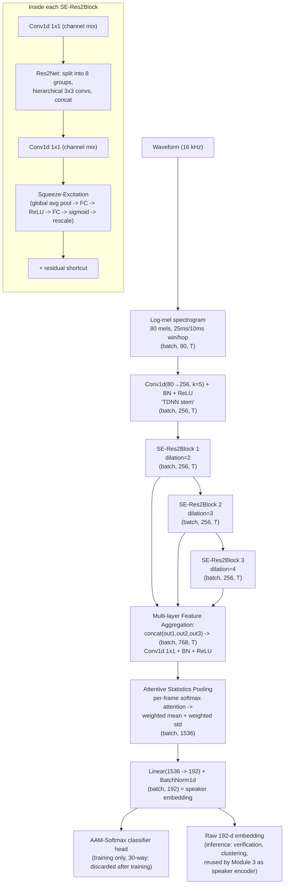
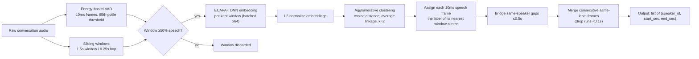

# Speaker Diarization — Sanmay Anand

**Module 2 of the CocktailFlow pipeline.** This module answers two related questions about a speech signal: *"what does this voice sound like, as a fixed-length vector?"* (speaker embedding / verification) and *"who was talking, and when?"* (diarization). It sits between Module 1 (separation), which hands it one clean stream per speaker, and Module 3 (voice conversion), which consumes this module's speaker embedding directly as its own speaker-identity encoder — the single tensor contract that glues the three modules into one pipeline. The architecture is **ECAPA-TDNN** (Desplanques et al., 2020), trained here with **AAM-Softmax / ArcFace** loss as a closed-set speaker classifier whose job, after training, is to be thrown away — only the embedding layer underneath it survives into deployment.

---

## 1. Theory

### 1.1 The speaker-embedding problem

A speaker-verification/diarization system needs a function that maps a variable-length audio clip to a **fixed-dimensional vector** (an "embedding" or "voiceprint") such that clips from the same speaker land close together in that vector space, and clips from different speakers land far apart — regardless of what words are being said. Once such a function exists, "diarization" (who spoke when) reduces to a much simpler downstream problem: chop the audio into short windows, embed each window, and cluster the embeddings.

Historically this used **i-vectors** (a low-dimensional projection of a GMM super-vector via a learned "total variability" subspace). Modern systems replace this with **neural embeddings** — d-vectors/x-vectors — produced by a deep network trained as a *speaker classifier* on a large labeled corpus. The classifier itself is discarded after training; what's reused is the second-to-last layer's activation, which has learned to be speaker-discriminative as a side effect of being forced to tell speakers apart. ECAPA-TDNN is the current state-of-the-art architecture in this x-vector family.

### 1.2 ECAPA-TDNN architecture

ECAPA-TDNN improves on the original x-vector TDNN in three specific ways, all present in this implementation:

**(a) SE-Res2Blocks instead of plain 1-D convolutions.**

*Res2Net* widens the effective receptive field of a convolutional block without adding parameters, by splitting the channel dimension into `scale` groups and processing them **hierarchically**: the first group passes through untouched, the second group is convolved on its own, the third group is *added to the second group's output* before being convolved, and so on. Formally, for groups $x_1, \dots, x_s$ (where $s = $ `scale`):

$$
y_i = \begin{cases} x_i & i = 1 \\ K_i(x_i) & i = 2 \\ K_i(x_i + y_{i-1}) & 2 < i \le s \end{cases}
$$

where $K_i$ is a small (kernel-size-3) convolution. Because group $i$'s receptive field is built on top of group $i-1$'s already-expanded receptive field, the *effective* receptive field across the whole block grows roughly linearly with $s$ even though every $K_i$ is a cheap, narrow convolution — this is the "multi-scale" part of the name.

*Squeeze-and-Excitation (SE)* then recalibrates the resulting channels with a learned, **content-dependent** per-channel gain. It squeezes the time axis away with global average pooling, passes the resulting per-channel vector through a small bottleneck MLP, and uses a sigmoid to produce a gate in $[0,1]$ per channel:

$$
z_c = \frac{1}{T}\sum_{t=1}^{T} x_{c,t} \qquad \text{(squeeze)}
$$
$$
g = \sigma\big(W_2\,\mathrm{ReLU}(W_1 z)\big) \qquad \text{(excitation)}
$$
$$
\tilde{x}_{c,t} = g_c \cdot x_{c,t} \qquad \text{(recalibration)}
$$

This lets the network boost or suppress entire channels based on the *global* statistics of the current utterance (e.g. its overall pitch/energy profile), not just local context.

**(b) Multi-layer Feature Aggregation (MFA).** Rather than only using the output of the final convolutional block (as a plain TDNN would), ECAPA-TDNN **concatenates the outputs of every SE-Res2Block** along the channel axis before pooling. This gives the pooling layer simultaneous access to shallow (fine-grained, short-context) and deep (abstract, long-context) representations in a single vector per frame, instead of forcing all information to funnel through the final layer alone.

**(c) Attentive Statistics Pooling (ASP).** A plain TDNN/x-vector pools frames into an utterance-level vector by simple averaging (and optionally the standard deviation) across time, giving every frame equal weight. ASP instead *learns* a per-frame, per-channel attention weight and uses it to compute a weighted mean and a weighted standard deviation:

$$
\alpha_{c,t} = \mathrm{softmax}_t\big(W_2\,\mathrm{ReLU}(W_1 x_{:,t})\big)_{c}
$$
$$
\tilde{\mu}_c = \sum_t \alpha_{c,t}\, x_{c,t}, \qquad
\tilde{\sigma}_c = \sqrt{\sum_t \alpha_{c,t}\, x_{c,t}^2 - \tilde{\mu}_c^2}
$$

The pooled descriptor is $[\tilde{\mu} \,\Vert\, \tilde{\sigma}]$ — frames that are more speaker-discriminative (e.g. voiced, stable-pitch segments) can be up-weighted relative to noisy or transient frames, and because both a mean *and* a (attention-weighted) variance are kept, the pooled vector captures something about the **distribution** of the speaker's acoustics across the utterance, not just its centroid.

### 1.3 AAM-Softmax / ArcFace loss

A speaker classifier trained with plain softmax cross-entropy only has to make classes *separable* — it has no pressure to make them separable by a comfortable margin, and plain softmax embeddings are known to cluster into "pie slices" radiating from the origin rather than tight, well-separated angular clusters. This matters enormously for an **open-set** task like speaker verification/diarization, where at *test* time the network must generalize its notion of "distance" to speakers it has never seen as a training class.

AAM-Softmax (the loss behind ArcFace in face recognition, adapted here to speakers) fixes this by operating purely in the **angular domain**. Both the embedding and each class's weight vector are L2-normalized, so the raw logit for class $j$ becomes exactly $\cos\theta_j$, the cosine of the angle between the embedding and that class's weight vector. An additive angular margin $m$ is then inserted *inside the cosine* for the target class only, before everything is rescaled by $s$ and passed through softmax:

$$
\mathcal{L}_{\text{AAM}} = -\log \frac{e^{\,s\cos(\theta_{y_i}+m)}}{e^{\,s\cos(\theta_{y_i}+m)} + \sum_{j \ne y_i} e^{\,s\cos\theta_j}}
$$

Because $\cos$ is decreasing on $[0,\pi]$, adding $m$ to the target angle makes $\cos(\theta_{y_i}+m) < \cos\theta_{y_i}$ — the loss now sees a *harder* (smaller) target logit than the embedding's raw angle would produce, so gradient descent has to push the embedding *closer* to its class centre than plain softmax would ever require, just to reach the same loss value. The net effect is embeddings for the same speaker are pulled into a tighter angular cone, and different speakers' cones are pushed apart by at least $\approx m$ radians — exactly the margin, measured in angle, that later lets a *held-out* speaker's embedding fall into its own separated region of the sphere rather than bleeding into a training speaker's territory. The scale $s$ is necessary because cosines live in $[-1,1]$, which is too flat a range for softmax/cross-entropy to produce useful gradients; multiplying by $s\approx30$ stretches the logits back out to a range where softmax is well-conditioned.

### 1.4 Voice Activity Detection (VAD)

The VAD here (`speech_activity`) is a simple, un-learned **energy-based** detector: it computes framewise RMS energy, converts to dB, and marks a frame as speech if its energy is within `threshold_db` of the loudest part of the signal (the 95th percentile of the energy distribution). This is a classical, parameter-free approach — no neural VAD model is trained or loaded — that works well on clean, single-channel audio with silence between turns, which is exactly what this project's synthetic test data looks like.

### 1.5 Agglomerative clustering for diarization

Diarization here is **not** a sequence model — it's clustering. The pipeline embeds many short, overlapping windows of the audio, L2-normalizes each embedding onto the unit hypersphere, and runs **agglomerative (bottom-up hierarchical) clustering** with cosine distance and average linkage, cut at a fixed number of clusters $k$ (2, since the whole project is scoped to two-speaker conversations). Agglomerative clustering starts with every embedding as its own cluster and repeatedly merges the two closest clusters (by average pairwise cosine distance between their members) until only $k$ remain — it needs no initialization and, unlike k-means, doesn't implicitly assume spherical, equal-variance clusters.

### 1.6 Diarization Error Rate (DER)

DER is the standard metric for "how wrong is this diarization," defined **per unit of reference speech time**, with three mutually exclusive error types measured frame-by-frame:

$$
\text{DER} = \frac{\underbrace{T_{\text{miss}}}_{\text{ref. speech, no hyp. speech}} + \underbrace{T_{\text{FA}}}_{\text{hyp. speech, no ref. speech}} + \underbrace{T_{\text{conf}}}_{\text{both speak, wrong speaker assigned}}}{T_{\text{ref. speech}}}
$$

Because the clustering algorithm produces arbitrary cluster *names* ("Speaker_0", "Speaker_1", ...) that have no inherent correspondence to the ground-truth speaker labels, DER scoring must first find the **optimal one-to-one mapping** between hypothesis clusters and reference speakers — the mapping that *maximizes total frame overlap* — before confusion can even be measured. This optimal bipartite matching is exactly the **assignment problem**, solved here with the Hungarian algorithm (`scipy.optimize.linear_sum_assignment`) on the negative overlap-count matrix.

### 1.7 Equal Error Rate (EER) for speaker verification

EER measures how well the embedding *space itself* separates speakers, independent of any clustering or downstream decision rule. Given many **trials** — pairs of utterances, each either a genuine (same-speaker) pair or an impostor (different-speaker) pair — and a similarity score for each pair (cosine similarity between their embeddings), sweeping a decision threshold from low to high traces out a **false-positive rate** (impostor pairs wrongly accepted) and a **false-negative rate** (genuine pairs wrongly rejected) that move in opposite directions. The **Equal Error Rate** is the single point where these two curves cross — the threshold at which the system is equally likely to wrongly accept an impostor as to wrongly reject a genuine match. A lower EER means the two score distributions (genuine vs. impostor) overlap less.

---

## 2. Architecture diagrams

### 2.1 ECAPA-TDNN network (per-utterance embedding extraction)

All channel counts below are this project's actual configured values (`channels: 256`, not the ECAPA-TDNN paper's 512–1024 — deliberately shrunk for a 30-speaker, CPU-trained setting).

### 2.2 Full diarization pipeline ("who spoke when")

---

## 3. Implementation notes

### 3.1 Feature extraction — `models/diarization.py:36-45`

Log-mel features are extracted with 80 mel bins and a 512-point FFT, using a 25 ms analysis window and 10 ms hop at 16 kHz (`win_length=400`, `hop_length=160` samples). After converting to log-power, each mel band's mean is subtracted over time — **cepstral mean normalization (CMN)** — which removes constant channel/recording-level offsets per utterance, so the network sees relative spectral shape rather than absolute loudness.

### 3.2 Squeeze-and-Excitation — `models/diarization.py:52-70`

`SEBlock` is a direct implementation of the squeeze → bottleneck MLP → sigmoid-gate → rescale formula from §1.2(a): global average pooling over time, a linear bottleneck down to `channels/reduction` (reduction ratio 8, so 256 channels bottleneck to 32), ReLU, a linear expansion back to `channels`, and a sigmoid gate that rescales the original feature map channel-by-channel.

### 3.3 Res2Net hierarchical grouping — `models/diarization.py:73-101`

`Res2NetBlock` splits its input into `scale=8` groups of 32 channels each. The first group passes straight through untouched (an identity "skip" group, as in the original Res2Net paper); each subsequent group is convolved only after being summed with the *previous group's already-convolved output* — the hierarchical recurrence from §1.2(a). The block-level `dilation` argument (2, 3, 4 for the three ECAPA layers — see §3.5) is applied to every one of the 3×3 convolutions inside the block, which is how ECAPA-TDNN grows temporal context across its three stacked blocks without growing kernel size.

### 3.4 SE-Res2Block assembly — `models/diarization.py:104-123`

`SERes2NetBlock` assembles the full block from §1.2(a) in order: **1×1 conv (channel mix-in) → Res2Net (multi-scale 3×3 convs) → 1×1 conv (channel mix-out) → SE (channel recalibration) → residual add**. The two 1×1 convolutions bookending the Res2Net core are a standard bottleneck pattern — they let the expensive multi-scale work happen at a controlled channel width while the block's input/output channel counts stay flexible.

### 3.5 Full network — `models/diarization.py:148-201`

`ECAPATDNN` chains three `SERes2NetBlock`s **sequentially** (layer 2 consumes layer 1's output, layer 3 consumes layer 2's output, with dilations 2, 3, 4 respectively) rather than running them in parallel on the stem's output. Multi-layer Feature Aggregation then concatenates all three *intermediate* outputs — each already 256 channels, giving 768 channels into the pooling stage — through a 1×1 conv + BatchNorm + ReLU before Attentive Statistics Pooling and the final linear projection to a 192-d, batch-normalized embedding. The class's constructor default (`channels=512`) is overridden by `configs/diarization.yaml` to **256** at `build_model()` time (§3.8) — this project never actually instantiates the 512-channel paper-scale version.

### 3.6 Attentive Statistics Pooling — `models/diarization.py:126-145`

`AttentiveStatisticsPooling` computes the attention weights with a small two-layer 1×1-conv network ending in a softmax over the time axis, then uses those weights to form the weighted mean and weighted standard deviation from §1.2(c), concatenated into the pooled descriptor. One implementation detail worth noting: the softmax is applied **independently per channel** rather than as a single shared attention vector broadcast across all channels — a valid, slightly more expressive variant of the mechanism described in §1.2(c).

### 3.7 AAM-Softmax loss — `models/diarization.py:208-245`

`AAMSoftmax` is a direct, literal implementation of the formula in §1.3: it computes $\cos\theta_j$ for every class by L2-normalizing both the embedding and the classifier's weight matrix before a linear layer (a normalized linear layer *is* a bank of cosine similarities), recovers $\theta$ via `acos`, adds the margin **only to the target class's angle** (via a one-hot mask), converts back to cosine, rescales by $s$, and hands the result to ordinary cross-entropy — which is already $-\log(\text{softmax})$, so one `CrossEntropyLoss` call completes the entire AAM-Softmax formula from §1.3.

### 3.8 Public API — `models/diarization.py:257-469`

**Backend switch** (`_load_model`, lines 279–313): `backend()` reads `configs/diarization.yaml`'s `backend` key. `pretrained` loads SpeechBrain's `speechbrain/spkrec-ecapa-voxceleb` checkpoint (trained on VoxCeleb 1+2, thousands of speakers) via `EncoderClassifier.from_hparams`; `custom` instantiates `ECAPATDNN` from `build_model(config)` (line 266–272, which reads `channels: 256` etc. straight from the YAML) and loads `checkpoints/diarization.pt`. Both paths produce 192-dim embeddings, so everything downstream is backend-agnostic.

**`get_embedding(audio, sr)`** (lines 342–356): resamples to 16 kHz if needed, then calls `embed_batch([audio])[0]`. Note the docstring is explicit that the returned vector is **not length-normalized** — callers (including Module 3) are expected to L2-normalize or use cosine similarity themselves.

**`speech_activity(audio, sr, ...)`** (lines 359–368): the energy-VAD from §1.4 — 10 ms frames, RMS energy in dB, threshold at (95th-percentile loudness − 35 dB).

**`diarize(audio, sr, num_speakers=None)`** (lines 371–469) — the full pipeline from §2.2, step by step in code:
1. Resample to 16 kHz; run `speech_activity` for the VAD mask.
2. Build sliding windows (`window_sec=1.5`, `hop_sec=0.25`), with one extra window forced to end exactly at the clip's end so the tail isn't cut off (lines 410–413).
3. Keep only windows whose VAD-frame coverage is ≥50% speech (line 419); embed the kept windows in batches of 64 (line 428).
4. L2-normalize embeddings, then `sklearn.cluster.AgglomerativeClustering(n_clusters=num_speakers, metric='cosine', linkage='average')` (lines 429–435) — exactly the clustering described in §1.5.
5. Every 10 ms **speech** frame is assigned the cluster label of its temporally nearest window centre (lines 438–441) — non-speech frames get label `-1`.
6. Non-speech gaps of ≤0.5 s (`min_gap_sec`) that fall **between two windows of the same assigned speaker** are relabelled to bridge the turn (lines 444–455) — this is a specific and conservative rule: it only bridges a gap if the speaker label *before and after* the gap already agrees, so it can't incorrectly merge two different speakers' turns.
7. Runs of consecutive identical labels become output segments, with any run shorter than 0.1 s dropped as noise (lines 458–469).

---

## 4. Configuration reference (`configs/diarization.yaml`)

| Key | Value | Meaning |
|---|---|---|
| `backend` | `pretrained` | Which embedding model `get_embedding`/`diarize` actually use; `custom` switches to the from-scratch model below. |
| `pretrained.source` | `speechbrain/spkrec-ecapa-voxceleb` | HuggingFace Hub id for the pretrained SpeechBrain ECAPA-TDNN (VoxCeleb 1+2). |
| `model.channels` | `256` | Channel width of the stem conv and all 3 SE-Res2Blocks (paper default is 512–1024; shrunk for 30 training speakers on CPU). |
| `model.attention_channels` | `128` | Bottleneck width inside the ASP attention MLP. |
| `model.embedding_dim` | `192` | Final embedding size — **must match** `voice_conversion.yaml`'s `dim_emb`, since Module 3 consumes this embedding directly. |
| `data.n_mels` | `80` | Mel filterbank count. |
| `data.n_fft` | `512` | FFT size for the mel spectrogram. |
| `data.hop_length` | `160` | 10 ms hop at 16 kHz. |
| `data.win_length` | `400` | 25 ms analysis window at 16 kHz. |
| `training.epochs` | `30` | Configured epoch budget for `OneCycleLR`'s schedule (see §5 — the *saved* checkpoint is actually from epoch 20). |
| `training.crop_sec` | `2.0` | Random training crop length. |
| `training.batch_size` | `32` | |
| `training.learning_rate` | `0.002` | OneCycle peak LR. |
| `training.weight_decay` | `0.00002` | Adam weight decay. |
| `training.seed` | `42` | |
| `loss.margin` | `0.2` | AAM-Softmax angular margin $m$ (radians). |
| `loss.scale` | `30` | AAM-Softmax logit scale $s$. |
| `diarization.window_sec` | `1.5` | Sliding-window length for embedding extraction during `diarize()`. |
| `diarization.hop_sec` | `0.25` | Sliding-window hop. |
| `diarization.min_gap_sec` | `0.5` | Maximum non-speech gap bridged within one speaker's turn. |
| `diarization.num_clusters` | `2` | Fixed speaker count for clustering — this module is scoped to exactly 2 speakers, never estimated automatically. |

---

## 5. Training procedure

`training/train_diarization.py` trains `ECAPATDNN` as a **closed-set 30-way speaker classifier** over the project's 30 LibriSpeech dev-clean training speakers (`data/manifest.json`, built once by `scripts/prepare_data.py` and shared by all three modules so no held-out test speaker ever leaks into any training set).

- **Data**: 1,771 training utterances / 179 validation utterances across the 30 speakers (per-speaker 90/10 split — confirmed from `logs/train_diarization.log`).
- **Crops**: training samples a random 2.0 s crop per utterance (`training.crop_sec`); validation uses a deterministic centre crop instead, for stable, reproducible validation-accuracy tracking.
- **Augmentation** (`SpeakerDataset.__getitem__`, `training/train_diarization.py:60-78`): with 50% probability, a second utterance from a *different* training speaker is mixed in at a random SNR between 10 and 20 dB (both clips first RMS-normalized to −25 dB, then the interferer is attenuated by the sampled SNR before summing) — this is meant to make embeddings more tolerant of the residual cross-talk that Module 1's separation leaves behind in its output streams.
- **Optimizer**: Adam, peak LR 0.002, weight decay 2e-5, applied jointly to the `ECAPATDNN` parameters **and** the `AAMSoftmax` class-weight matrix (both are passed into the same optimizer, `training/train_diarization.py:114-116`).
- **Schedule**: `OneCycleLR` with `pct_start=0.15` — LR ramps up for the first 15% of total steps, then anneals down for the rest, over `epochs * len(train_loader)` total steps.
- **Model size**: 1,701,792 parameters (confirmed directly from `logs/train_diarization.log`, matching the README's "1.7M").
- **Actual run**: configured for 30 epochs, but the **best validation accuracy checkpoint was saved at epoch 20** (100.0% val accuracy, 12.6 minutes elapsed) — this is the checkpoint shipped in `checkpoints/diarization.pt`, matching the README's "~20 epochs, ~13 min" claim. Training continued logging past epoch 20 without improving on that best score within the log excerpt available.
- **Outputs**: `checkpoints/diarization.pt` (best-val-accuracy checkpoint, keyed by epoch/state-dict/speaker-list/val-accuracy) and a loss/accuracy curve figure at `results/loss_curves/diarization_loss_acc.png`. A separate `--tsne` mode (`visualize_tsne`, lines 185–215) embeds held-out test-speaker utterances and plots them in 2-D via t-SNE (cosine metric, perplexity 20) to `results/metrics/tsne_embeddings.png` — a qualitative check of whether unseen speakers still form visually separable clusters.

---

## 6. Evaluation

`evaluation/eval_diarization.py` reports two independent numbers, both computed **only on the 10 held-out test speakers** that never appear in any training split:

### 6.1 Speaker-verification EER (`evaluate_eer`)
For each of the 10 test speakers, 20 utterances are embedded (3.0 s crops), L2-normalized, and every pair's cosine similarity becomes one verification trial; genuine (same-speaker) vs. impostor (different-speaker) trials are separated by `sklearn.metrics.roc_curve`, and EER is read off where the false-positive and false-negative rates are closest.

**Actual result** (`results/metrics/speaker_verification.csv`): **10 speakers, 19,900 trials, EER = 10.92%**, mean same-speaker cosine similarity 0.649, mean different-speaker cosine similarity 0.097 — confirming the README's "EER 10.9%" is reproduced exactly, and showing the genuine/impostor score distributions are well-separated in their means even though the tails overlap enough to produce a two-digit EER.

### 6.2 Diarization Error Rate (`evaluate_der`)
Run on `data/diarization_test/`: 30 synthetic two-speaker turn-taking conversations built by `scripts/prepare_data.py`, each with ground-truth speaker/start/end CSVs. `diarize()` is run with `num_speakers=2` fixed, and `compute_der` (§1.6/§3 of this doc) scores each file at 10 ms frame resolution with **no forgiveness collar** (a standard leniency window around speaker-change boundaries that this evaluation deliberately omits, making the numbers stricter than many published DER results) and Hungarian-matched speaker labels.

**Actual result** (`results/metrics/diarization_der.csv`, duration-weighted over 582.1 s of audio): **DER = 14.45%** (miss 1.54%, false-alarm 3.84%, confusion 9.07%) — again reproducing the README's "DER 14.4%" exactly. Confusion dominates the error budget by a wide margin (9.07 of 14.45 points), and per-file DER is highly variable: most conversations score under 10%, but a handful (`conv_0010.wav` at 54.8%, `conv_0003.wav` at 37.0%) are much worse, indicating the clustering step occasionally mis-groups a whole turn rather than making many small boundary errors.

---

## 7. Known limitations

- **Open-set generalization is the real bottleneck, and the gap to closed-set performance is stark.** Training/validation accuracy on the 30 *seen* speakers reaches 100% by epoch 20, but EER on the 10 *held-out* speakers is 10.92% — a large gap that is expected given only 30 training identities (ECAPA-TDNN and AAM-Softmax were designed for thousands-of-speaker corpora like VoxCeleb), but worth stating plainly: closed-set accuracy here says almost nothing about real-world generalization.
- **Fixed two-speaker assumption.** `diarize()` always clusters into exactly `num_clusters` (default 2) — there is no automatic speaker-count estimation. This matches the project's stated two-speaker scope but means the function would silently misbehave (force-split or force-merge) on audio with a different number of speakers.
- **No-overlap assumption.** The VAD and clustering pipeline assumes one speaker talks at a time; overlapping speech is not modeled at all at this stage (the project's intended workaround is to run Module 1's separation first, then diarize each separated stream independently).
- **The custom model is a from-scratch training exercise, not a production-quality verification system.** With 256 channels and 30 training speakers, it is intentionally far smaller and far more data-constrained than the pretrained SpeechBrain checkpoint (20.8M parameters, VoxCeleb 1+2's thousands of speakers), which is why `backend: pretrained` is this module's default.
- **Train/eval crop-length mismatch.** Training crops are 2.0 s; the EER evaluation uses 3.0 s crops — a minor inconsistency that means the reported EER isn't measured at exactly the same utterance length the network was optimized on.
